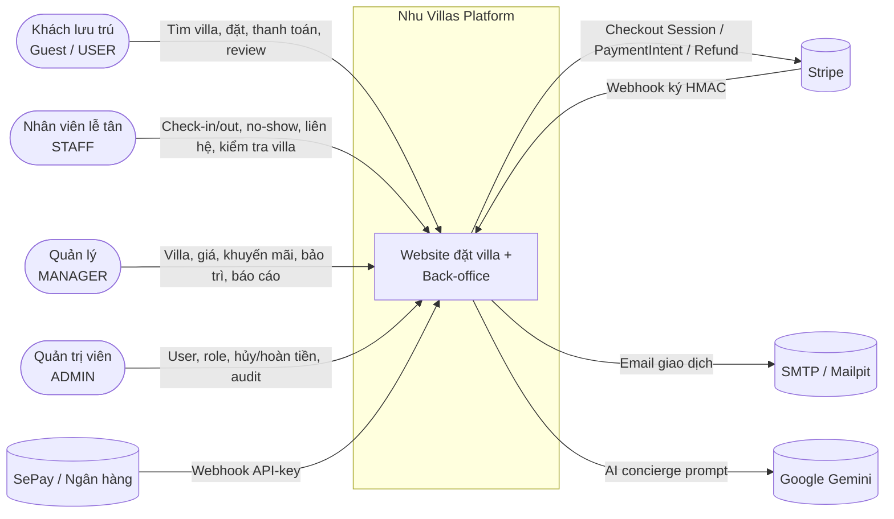
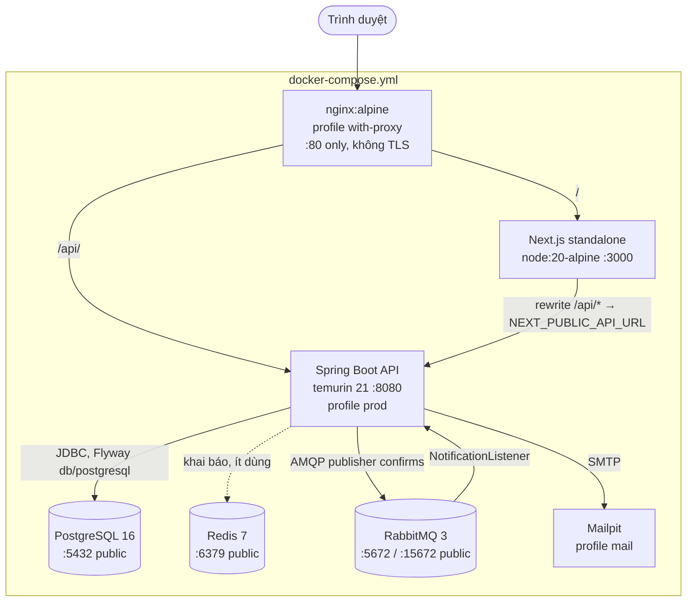
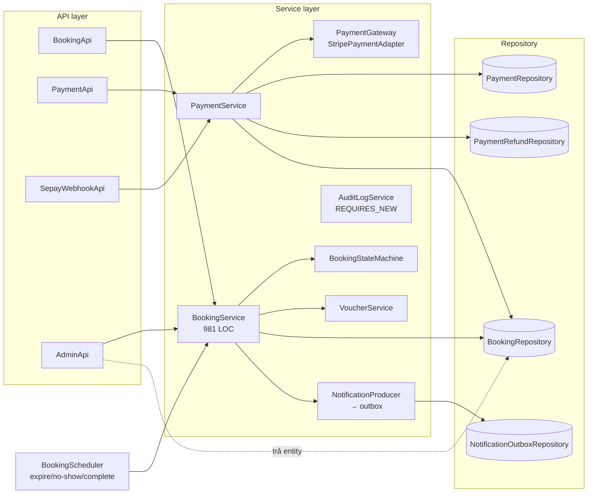
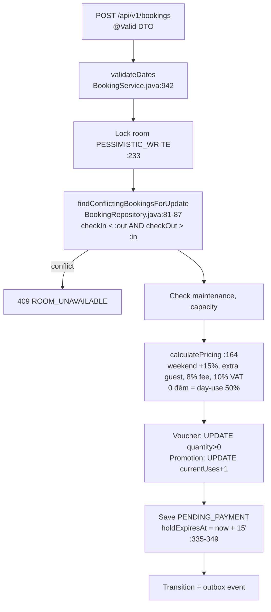

# Kiến trúc hiện tại (As-Is) — Nhu Villas

| Thuộc tính | Giá trị |
|---|---|
| Ngày audit | 2026-11-20 |
| Commit baseline | `7a3ccde` (branch `develop`) |
| Phạm vi | `backend/`, `frontend/`, `database/`, `docker-compose.yml`, `nginx.conf`, `.github/`, `legacy-mvc/` |
| Phương pháp | Đọc mã nguồn read-only; mọi trích dẫn `file:line` tính theo baseline |

> Tài liệu mô tả hệ thống **như đang tồn tại**, không phải thiết kế mong muốn. Thiết kế mục tiêu: [target-architecture.md](target-architecture.md).

---

## 1. Tổng quan

Nhu Villas là hệ thống đặt villa nghỉ dưỡng **một cơ sở** (Tuyền Lâm, Đà Lạt) gồm website đặt phòng trực tiếp và back-office vận hành. Không có khái niệm hotel/branch/tenant trong schema.

| Lớp | Công nghệ | Vị trí |
|---|---|---|
| Frontend | Next.js 15.5 (App Router), React 19, TypeScript strict, Tailwind v4, TanStack Query 5 | `frontend/` |
| Backend | Spring Boot 3.4.1, Java 21, Maven, Spring Security, JPA/Hibernate, Flyway | `backend/` |
| Database | PostgreSQL 16 (prod/compose); H2 (dev/test); SQL Server (legacy) | `backend/src/main/resources/db/*`, `database/` |
| Messaging | RabbitMQ 3 (transactional outbox → email) | `backend/.../notification` |
| Cache | Redis 7 (khai báo; session/rate-limit **không** dùng Redis) | `docker-compose.yml:25-40` |
| Payment | Stripe (Checkout + PaymentIntent), SePay (chuyển khoản VietQR, webhook API-key), manual | `payment/`, `service/payment/` |
| AI | Google Gemini qua WebClient | `common/service`, `ai/` |
| Reverse proxy | nginx (chỉ profile `with-proxy`) | `nginx.conf` |
| CI | GitHub Actions (1 workflow) | `.github/workflows/ci.yml` |
| Legacy | Spring MVC + Thymeleaf + SQL Server, **không còn chạy** | `legacy-mvc/` |

---

## 2. C4 Level 1 — System Context

---

## 3. C4 Level 2 — Container

Ghi chú:
- `backend` chỉ `depends_on: db` (healthy) — không chờ Redis/RabbitMQ (`docker-compose.yml`).
- Mount `./init-db.sql` (`docker-compose.yml:17`) trỏ tới file **không tồn tại** ở root (file thật: `database/init-db.sql`).
- Deploy thực tế hiện nay: backend lên Render (512 MB, `backend/Dockerfile` comment), frontend lên Vercel (`frontend/src/app/layout.tsx` metadataBase).

---

## 4. C4 Level 3 — Component (Backend)

### 4.1 Package hiện tại (183 class, ~17.4k LOC)

| Package | #Class | Vai trò | Ghi chú |
|---|---:|---|---|
| `room` (api/dto/model/repository/service) | 27 | Villa, RoomType, Amenity, VillaMaintenance, VillaInspection | Ôm cả inspection (vận hành) |
| `config` | 21 | Security, Rabbit, Redis, Web, DataInitializer, AdminCredentialValidator, GlobalExceptionHandler | Quá tải, lẫn bootstrap + cross-cutting |
| `exception` | 16 | Exception types | 5 class không dùng |
| `notification` | 12 | In-app notification, outbox, dispatcher, listener | Thiết kế tốt |
| `booking` | 10 | Booking, state machine, transitions | `BookingService` 981 dòng (cả analytics) |
| `common` | 9 | Email, Gemini, PDF, Excel, invoice, login attempts | "Grab-bag" |
| `user` / `security` | 8 / 7 | User, role; filters (CSRF, rate limit, session bridge) | |
| `payment` + `service/payment` | 7 + 3 | PaymentService, PaymentApi, SePay; Stripe/Mock adapter | Adapter nằm ngoài module |
| `promotion`, `voucher` | 7, 4 | Khuyến mãi, voucher | |
| `admin` | 5 | `AdminApi` 781 dòng, AuditLog | |
| `review`, `wishlist`, `profile`, `account` | 6, 5, 3, 1 | Guest self-service | |
| `report` | 3 | Excel/PDF, revenue | |
| `contact`, `faq`, `blog`, `ai`, `file` | 6, 5, 4, 3, 2 | Nội dung/hỗ trợ | |
| `scheduler`, `observability`, `health` | 1 mỗi | Booking jobs, RequestIdFilter | |

### 4.2 Component — luồng Booking & Payment

Điểm vi phạm boundary: `PaymentService` đọc/ghi trực tiếp `BookingRepository` và `BookingStatusTransitionRepository` (`payment/service/PaymentService.java:392,453`); `AdminApi` gọi repository của nhiều module.

---

## 5. Luồng nghiệp vụ chính (As-Is)

### 5.1 Tạo booking

Đã xác minh: lock theo row `rooms` tuần tự hóa các request cùng villa → **không double-book cho booking ≥ 1 đêm**. Với booking 0 đêm (`checkIn == checkOut`, được phép tại `BookingService.java:949`), điều kiện `checkIn < :out` không bao giờ đúng → hai day-use cùng ngày, hoặc day-use trùng ngày check-in của booking khác, đều lọt.

### 5.2 Thanh toán

| Kênh | Endpoint | Xác thực | Idempotency |
|---|---|---|---|
| Stripe Checkout | `POST /payments/stripe-checkout` → webhook `checkout.session.completed` | `Webhook.constructEvent` (HMAC) | `intent_id` UNIQUE; nhưng mỗi lần gọi tạo Session mới |
| Stripe PaymentIntent | `POST /payments/intent` → `payment_intent.succeeded` | HMAC | như trên |
| SePay | `POST /payments/webhook/sepay` | API key constant-time | `transaction_ref` UNIQUE; mismatch số tiền → không lưu record |
| Manual | `POST /payments/{id}/complete` | ADMIN (exact match) | lock row |

### 5.3 Hủy & hoàn tiền

- Hủy: `BookingService.cancelBooking` (`:511-548`) → `calculateRefund` (`:955-980`) set `refundAmount` theo policy (≥3 ngày 100%, 1–3 ngày 50%, <1 ngày 0%).
- Hoàn tiền: `PaymentService.refund` (`:345-464`) yêu cầu `Idempotency-Key`, ghi `payment_refunds`, gọi gateway, rồi **cộng** `refundAmount` vào booking (`:436-438`) → giá trị bị cộng đôi so với số policy.
- `StripePaymentAdapter.refund` trả `true` (giả lập) khi Stripe tắt hoặc payment không có intent (`service/payment/StripePaymentAdapter.java:186-198`) → SePay/manual "hoàn tiền thành công" mà không chuyển tiền.

### 5.4 Thông báo

Business transaction ghi `notification_outbox` → `NotificationOutboxDispatcher` khóa batch, publish RabbitMQ (publisher confirms, exponential backoff) → `NotificationListener` gửi email. At-least-once (`docs/BOOKING_LIFECYCLE_AND_RBAC.md:66-79`).

---

## 6. Bảo mật (As-Is)

| Kiểm soát | Hiện trạng | Vị trí |
|---|---|---|
| Authentication | HttpSession (JSESSIONID); `SessionAuthBridgeFilter` nạp lại User từ DB mỗi request | `config/SessionAuthBridgeFilter.java` |
| Authorization | URL rules + `@PreAuthorize` class-level ở admin; nhiều check thủ công `"ADMIN".equals(role)` (16 chỗ / 7 file) | `config/SecurityConfig.java:100-136`, `booking/service/BookingService.java:514,612` |
| Role | `USER < STAFF < MANAGER < ADMIN` (hierarchy) | `docs/BOOKING_LIFECYCLE_AND_RBAC.md:124-142` |
| Password | BCrypt mặc định; lockout 5 lần/15' in-memory | `common/service/LoginAttemptService.java` |
| CSRF | Double-submit tự viết; cookie `XSRF-TOKEN` ghi `HttpOnly=false` → trình duyệt coi là HttpOnly | `security/CsrfCookieFilter.java:96` (baseline) |
| CORS | Allowlist `app.cors.allowed-origins`, credentials | `SecurityConfig` |
| Rate limit | In-memory per IP, map không dọn; `RateLimiterInterceptor` không được đăng ký | `config/RateLimitFilter.java` |
| Secrets | Env vars; default yếu ở profile dev/postgres; `AdminCredentialValidator` coi profile null/default là dev → `admin123` | `config/AdminCredentialValidator.java:56,163-170` |
| Email verification | Tự verify khi email tắt (mặc định prod tắt) | `user/service/UserService.java:170-172` |
| Session cookie prod | Secure, HttpOnly, SameSite=None (mặc định) | `application-prod.properties:58-61` |

---

## 7. Dữ liệu (As-Is)

25 bảng PostgreSQL sau V12 (chi tiết: [database-design.md §2](database-design.md#2-schema-hiện-tại)). Ba track migration song song:

| Track | Dùng bởi | Ghi chú |
|---|---|---|
| `db/postgresql` V1, V4–V12 | profile `prod` (`application-prod.properties:40-43`) | Thiếu V2/V3 |
| `db/migration` V1–V3, V6–V11 | profile `dev` (H2) | Thiếu V12; cú pháp H2 |
| `db/postgresql-legacy` | không dùng | |
| `database/*.sql`, `backend/*.sql` | thủ công, SQL Server | Status cũ (AWAITING_PAYMENT…) |

Profile `postgres` (local) tắt Flyway và dùng `ddl-auto=update` (`application-postgres.properties:10,16`).

---

## 8. Frontend (As-Is)

| Hạng mục | Hiện trạng |
|---|---|
| Cấu trúc | `src/app/*` route mỏng → `src/features/{account,admin,ai,auth,booking,content,home,profile,villas}`; `src/shared/{api,auth,components,hooks,i18n,settings}` |
| API | `src/shared/api/client.ts` tập trung: CSRF header, unwrap envelope `{data}`, `ApiError` có `X-Request-Id`, 401 → redirect login |
| State | TanStack Query (retry 1, stale 30s) + Context (Session, Settings) + sessionStorage cho booking draft |
| Auth guard | `RequireAuth` client-side; không có `middleware.ts`; `/admin` chỉ yêu cầu đăng nhập (lọc tab theo role tại `features/admin/AdminDashboardPage.tsx:151-155`) |
| File quá lớn | `AdminExtendedPanels.tsx` 1535, `AdminDashboardPage.tsx` 1395, `AuthPages.tsx` 1007 dòng |
| Test | 1 unit test (`features/booking/__tests__/bookingEngine.test.ts`) |
| Rủi ro | Demo login hardcode password (`features/auth/AuthPages.tsx:337,352,447`); session stale hiển thị đã login; `SettingsProvider` render `opacity-0` trước mount |

---

## 9. Hạ tầng & vận hành (As-Is)

| Hạng mục | Hiện trạng |
|---|---|
| Docker | Backend/Frontend multi-stage, non-root; backend JVM tune cho 512 MB (`-Xmx220m`, SerialGC) |
| Compose | DB/Redis/RabbitMQ publish port ra host; default password yếu (`docker-compose.yml:33,48-49`); không resource limit; mailpit/nginx tag không pin |
| nginx | Chỉ `listen 80` (`nginx.conf:54`); `add_header` trong `location /api/` và `/_next/static/` làm mất security header cấp server; `Access-Control-Allow-Origin *` (`nginx.conf:92`); `proxy_cache_valid` không có `proxy_cache_path` (`:123`) |
| CI | `.github/workflows/ci.yml`: `mvnw test` (H2) + `tsc`/vitest/build; không lint, không scan, không build image, không deploy |
| Logging | Text log + requestId (`logback-spring.xml`); không JSON |
| Monitoring | Actuator `health,info` only; không Prometheus/Grafana |
| Backup | Không có script; không có quy trình restore |
| Môi trường | Profiles dev/postgres/prod/test; không có staging |
