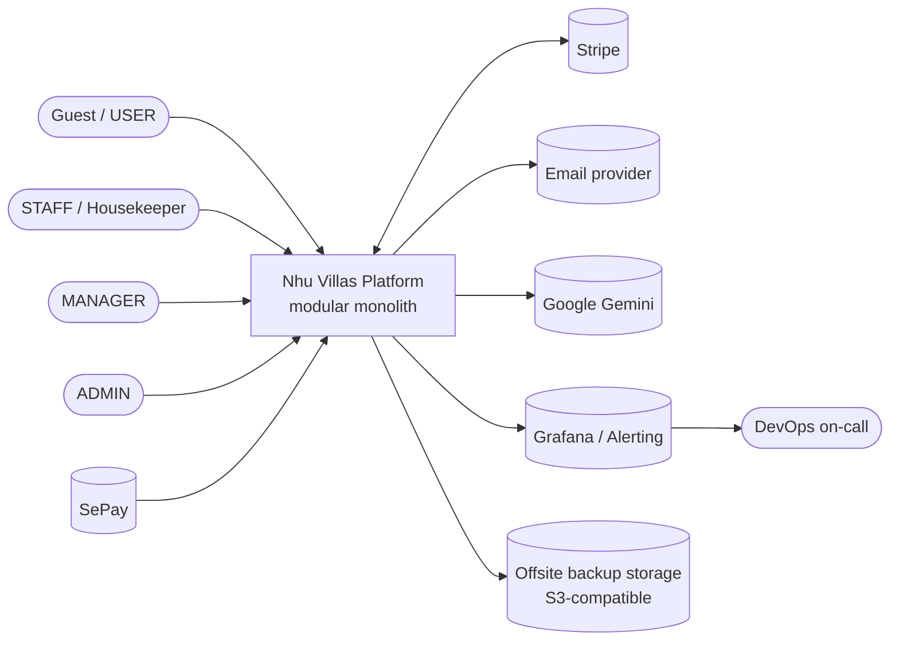
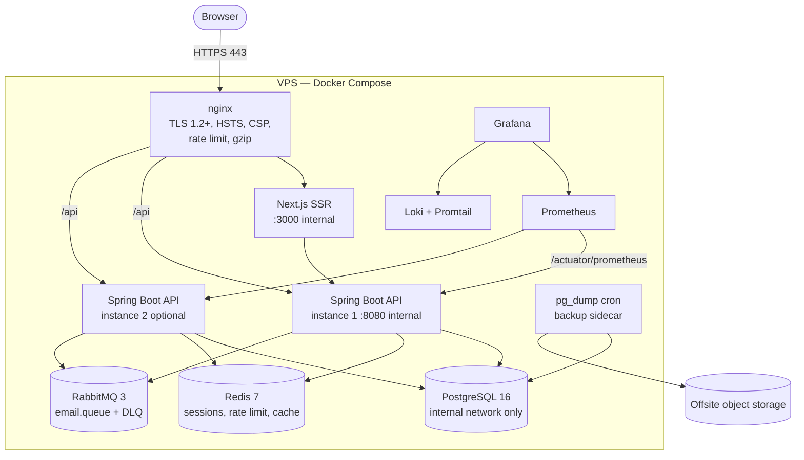
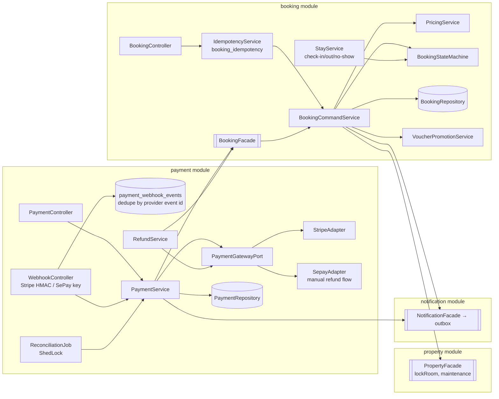
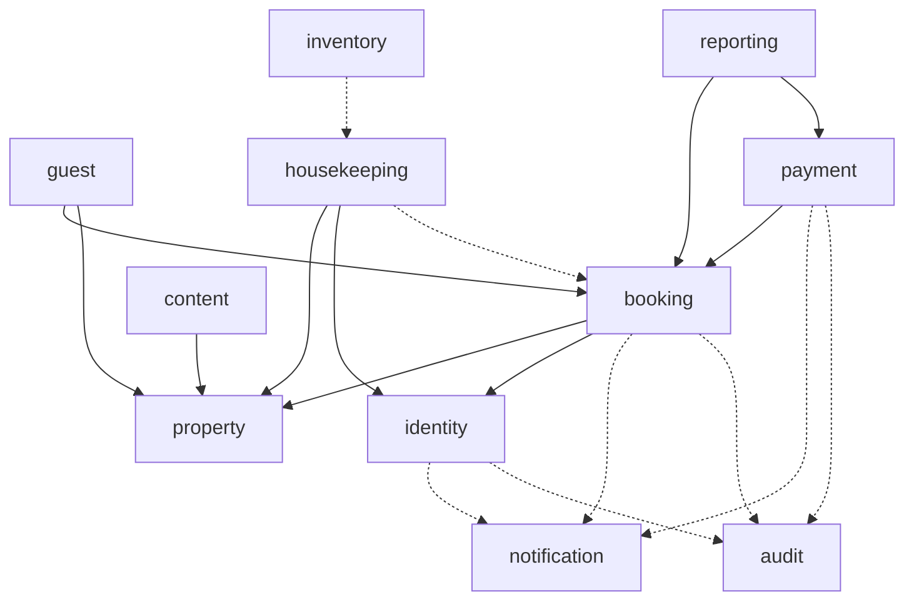
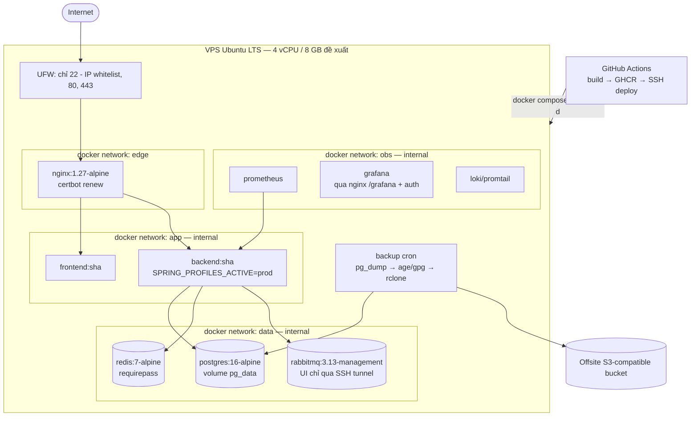

# Target Architecture (To-Be) — Nhu Villas Hotel Management Platform

| Thuộc tính | Giá trị |
|---|---|
| Ngày | 2026-11-20 |
| Trạng thái | Proposed — triển khai tăng dần theo [implementation-plan.md](../roadmap/implementation-plan.md) |
| Quyết định nền | [ADR-0001](../adr/0001-modular-monolith.md) Modular monolith · [ADR-0002](../adr/0002-single-flyway-postgresql-track.md) · [ADR-0003](../adr/0003-double-booking-prevention.md) · [ADR-0004](../adr/0004-transactional-outbox-rabbitmq.md) · [ADR-0005](../adr/0005-session-auth-spring-session-redis.md) · [ADR-0006](../adr/0006-testcontainers-integration-testing.md) · [ADR-0007](../adr/0007-docker-compose-vps-deployment.md) · [ADR-0008](../adr/0008-single-property-multi-property-ready.md) |

---

## 1. Nguyên tắc kiến trúc

1. **Modular monolith trước, microservices khi có bằng chứng** — một deployable Spring Boot, ranh giới module rõ ràng; tách service chỉ khi một module có nhu cầu scale/release độc lập đo được.
2. **Module sở hữu dữ liệu của mình** — chỉ module chủ được đọc/ghi bảng của nó qua repository; module khác dùng public API (Java interface) hoặc domain event.
3. **Toàn vẹn nghiệp vụ được bảo vệ hai lớp** — invariant quan trọng (không chồng lịch, không trùng payment) có cả kiểm tra ở service lẫn ràng buộc DB.
4. **Side-effect bất đồng bộ qua outbox** — email/webhook ra ngoài không nằm trong transaction nghiệp vụ.
5. **Stateless app tier** — session, rate limit, lock ở Redis/PostgreSQL để chạy ≥ 2 instance.
6. **API là DTO** — không serialize entity; contract được architecture test bảo vệ.
7. **Single-property, multi-property ready** — `property_id` được đưa vào schema nhưng chưa có UI/RBAC theo chi nhánh.

---

## 2. Module

### 2.1 Cấu trúc package chuẩn của một module

```
com.hsf.hotel.<module>
├── api/              # REST controllers, request/response DTO (chỉ phụ thuộc application)
├── application/      # Use-case services; <Module>Facade = public interface cho module khác
│   └── event/        # Domain events công bố ra ngoài (record bất biến)
├── domain/           # Entities, value objects, state machine, domain rules
└── infrastructure/   # Spring Data repositories, adapter gateway ngoài (package-private khi có thể)
```

Quy tắc ArchUnit (P3): `..<A>.infrastructure..` chỉ được truy cập từ `..<A>..`; `..api..` không phụ thuộc `..infrastructure..`; kiểu trả về controller không chứa `@Entity`.

### 2.2 Danh mục module

| Module | Trách nhiệm | Dữ liệu sở hữu | Public interface (Facade / Event) | Phụ thuộc | Transaction boundary |
|---|---|---|---|---|---|
| **identity** | Đăng ký, đăng nhập, phiên, role/permission, hồ sơ tài khoản, khóa tài khoản | `users` (+ `user_roles` khi cần), Spring Session tables/Redis | `IdentityFacade.currentUser()`, `findUserSummary(id)`; event `UserRegistered`, `UserDisabled` | notification (event) | Mỗi use-case một transaction; lockout counter ở Redis |
| **property** | Property, villa, loại villa, tiện ích, gallery, giá cơ bản, lịch bảo trì | `properties` (mới), `rooms`, `room_types`, `amenities`, `room_amenities`, `room_gallery_images`, `villa_maintenances` | `PropertyFacade.getRoomForBooking(id)`, `lockRoom(id)`, `hasMaintenance(room, range)`; event `MaintenanceScheduled` | — | CRUD đơn giản; `lockRoom` chạy trong transaction của caller |
| **booking** | Reservation lifecycle, availability, hold, pricing, voucher, promotion, check-in/out, no-show | `bookings`, `booking_status_transitions`, `vouchers`, `promotions`, `promotion_rooms`, `booking_idempotency` (mới) | `BookingFacade.getBookingForPayment(id)`, `markPaid(bookingId, paymentRef)`, `applyRefund(bookingId, totalRefunded)`; events `BookingCreated`, `BookingPaid`, `BookingCancelled`, `BookingExpired`, `GuestCheckedOut` | property, identity | **Tạo booking**: 1 transaction (lock room → conflict check → pricing → voucher → insert → outbox). Ràng buộc DB EXCLUDE là lưới cuối |
| **guest** | Hồ sơ khách, sở thích, wishlist, review | `wishlists`, `reviews`, `review_photos`, (sau) `guest_profiles` | `GuestFacade.canReview(user, booking)`; event `ReviewPosted` | booking (đọc trạng thái), property | Mỗi thao tác một transaction |
| **payment** | Payment intent/session, webhook, idempotency, refund, reconciliation, gateway adapters | `payments`, `payment_refunds`, `payment_webhook_events` (mới), `reconciliation_items` (mới) | `PaymentFacade.paymentsOf(bookingId)`; events `PaymentSucceeded`, `PaymentFailed`, `RefundSucceeded` | booking (Facade), notification | **Webhook**: 1 transaction (lock payment → lock booking qua `BookingFacade.markPaid` → outbox). Gọi gateway **ngoài** transaction DB khi có thể; refund ghi `PROCESSING` trước, cập nhật kết quả sau |
| **housekeeping** (mới) | Trạng thái buồng phòng, task dọn, phân công, inspection | `room_status` (mới), `housekeeping_tasks` (mới), `villa_inspections` | `HousekeepingFacade.isReadyForCheckIn(roomId)`; event `RoomReady`, `TaskAssigned` | property, identity; nghe `GuestCheckedOut`, `MaintenanceScheduled` | Mỗi chuyển trạng thái task một transaction + optimistic lock `@Version` |
| **inventory** (sau) | Vật tư, xuất/nhập, định mức theo task | `inventory_items`, `stock_movements` | `InventoryFacade.consume(...)` | housekeeping (event) | Transaction theo movement |
| **notification** | Outbox, dispatcher, consumer email, thông báo in-app, template | `notification_outbox`, `notifications`, `processed_messages` (mới) | `NotificationFacade.enqueue(event)` (gọi trong transaction caller); nghe mọi domain event | — | Ghi outbox **cùng** transaction caller; dispatch transaction riêng |
| **reporting** | Doanh thu, occupancy, export | Không sở hữu bảng (read model / SQL view) | `ReportingFacade.revenue(range)` | đọc view của booking, payment | Read-only transaction |
| **audit** | Audit trail bảo mật & nghiệp vụ, retention | `audit_logs` | `AuditFacade.record(action, entity, actor)` | — | `REQUIRES_NEW` (giữ như hiện tại) |
| **content** (supporting) | Blog, FAQ, liên hệ, AI concierge | `blogs`, `faq_items`, `contact_messages`, `chat_messages` | — | property (đọc villa cho AI) | Đơn giản |

Ghi chú tách nhỏ `BookingService` (~980 dòng): `BookingCommandService` (create/modify/cancel/expire), `PricingService`, `StayService` (check-in/out/no-show), `BookingQueryService`; analytics chuyển sang **reporting**.

---

## 3. C4 Level 1 — System Context (To-Be)



## 4. C4 Level 2 — Container (To-Be)



## 5. C4 Level 3 — Component: Booking & Payment (To-Be)



Luồng thay đổi chính so với As-Is:
- `PaymentService` không còn chạm `BookingRepository`; gọi `BookingFacade.markPaid/applyRefund`.
- Tạo Stripe session: tìm session `open` hiện có của booking trước khi tạo mới (chống thu tiền 2 lần).
- Webhook ghi `payment_webhook_events(provider, event_id)` UNIQUE trước khi xử lý (dedupe tầng event).
- Refund SePay/manual chuyển `MANUAL_PENDING` → ADMIN xác nhận đã chuyển khoản → `SUCCEEDED`.

## 6. Module Dependency Diagram

Mũi tên = "phụ thuộc vào (gọi Facade)". Nét đứt = "nghe domain event". Không cho phép vòng phụ thuộc.



Hướng dependency: `payment → booking → property` (payment biết booking; booking không biết payment — trạng thái `PAID` được set qua `BookingFacade.markPaid`). Housekeeping nghe `GuestCheckedOut` thay vì booking gọi housekeeping, giữ booking độc lập.

## 7. Deployment Diagram (VPS + Docker Compose)



Môi trường:

| Môi trường | Hạ tầng | Dữ liệu | Mục đích |
|---|---|---|---|
| Development | `docker-compose.yml` + `docker-compose.dev.yml` (ports mở, Mailpit) trên máy dev | Seed (`DataInitializer`, profile `seed`) | Phát triển |
| Testing | GitHub Actions + Testcontainers | Ephemeral | CI |
| Staging | VPS nhỏ hoặc cùng VPS khác project name, `docker-compose.staging.yml`, Stripe test mode | Bản sao ẩn danh hóa | UAT, restore drill |
| Production | VPS, `docker-compose.prod.yml`, secrets qua `.env` quyền 600 / Docker secrets | Thật | Vận hành |

## 8. Cross-cutting concerns

| Concern | Thiết kế |
|---|---|
| AuthN | Session cookie (Spring Session Redis), `HttpOnly; Secure; SameSite=Lax` — ADR-0005 |
| AuthZ | `@PreAuthorize` + `RoleHierarchy` (`ADMIN > MANAGER > STAFF > USER`), test ma trận quyền |
| CSRF | Double-submit cookie `XSRF-TOKEN` (JS-readable), header `X-XSRF-TOKEN` |
| Rate limit | nginx (thô) + Bucket4j Redis theo user/IP cho login, booking, AI |
| Idempotency | `Idempotency-Key` cho POST booking/refund; unique key ở DB |
| Concurrency | Pessimistic lock room + EXCLUDE constraint; `@Version` cho booking/payment/task |
| Scheduling | ShedLock (bảng `shedlock` PostgreSQL) cho mọi `@Scheduled` |
| Logging | JSON (logstash-logback-encoder), MDC `requestId`, `userId`, `bookingId`; redact PII |
| Metrics | Micrometer Prometheus: HTTP RED, JVM, Hikari, outbox backlog, webhook kết quả, booking created/expired |
| Tracing | Micrometer Tracing (OTel) **khi cần** — chưa bật mặc định vì chỉ có một service |
| Error | `GlobalExceptionHandler` envelope; map `23P01` → 409 `ROOM_UNAVAILABLE`, `23505` → 409 |
| Secrets | Biến môi trường từ file `.env` ngoài repo (quyền 600); gitleaks trong CI |
