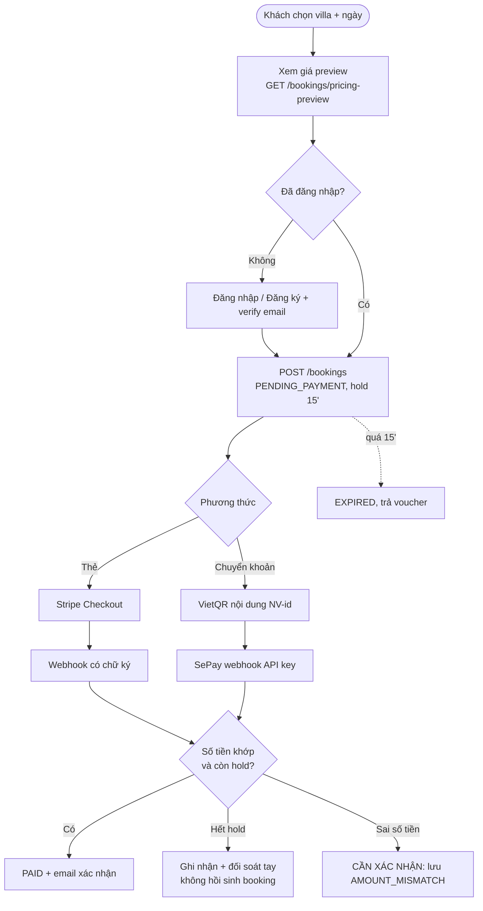
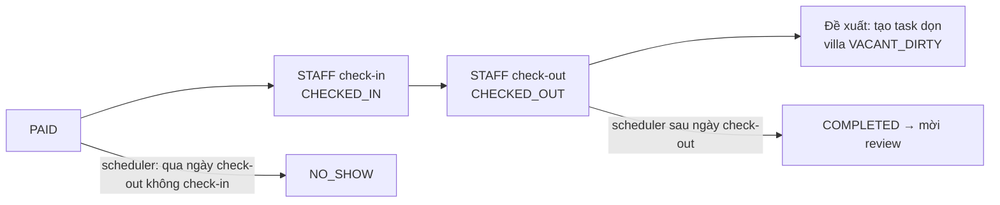
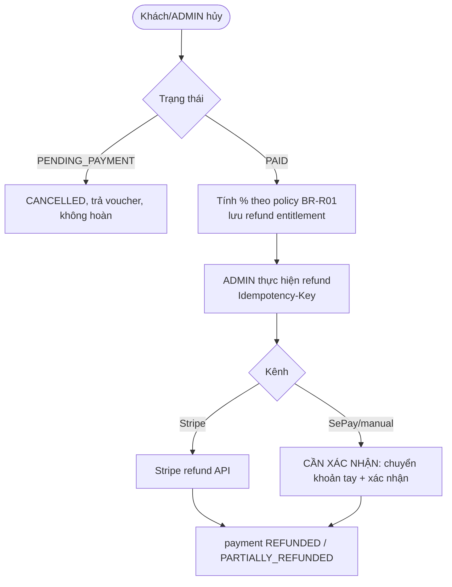
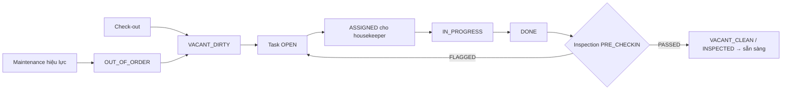

# Business Analysis — Nhu Villas Hotel Management Platform

| Thuộc tính | Giá trị |
|---|---|
| Ngày | 2026-11-20 |
| Nguồn chân lý hiện hành | [`docs/BOOKING_LIFECYCLE_AND_RBAC.md`](../BOOKING_LIFECYCLE_AND_RBAC.md) (Accepted 2026-09-11) |
| Nguồn bổ trợ | Mã nguồn baseline `7a3ccde`; [`docs/BUSINESS_ANALYSIS.md`](../BUSINESS_ANALYSIS.md) (gap analysis cũ, **một phần lỗi thời**: mô tả trước khi có payment, STAFF/MANAGER) |
| Phạm vi | Single-property (Nhu Villas, Đà Lạt), thiết kế multi-property ready ([ADR-0008](../adr/0008-single-property-multi-property-ready.md)) |

**Quy ước**
- `[Nguồn: …]` — quy tắc có căn cứ trong tài liệu được chấp nhận hoặc mã nguồn.
- **[CẦN XÁC NHẬN]** — quy tắc chưa có căn cứ hoặc hiện có mâu thuẫn; cần chủ villa/PO xác nhận trước khi triển khai. Không được hiện thực hóa như sự thật.
- `Hiện trạng`: ✔ có · ⚠ một phần · ❌ chưa có.

---

## 1. Actors

| Actor | Loại | Mô tả | Căn cứ |
|---|---|---|---|
| Guest (khách vãng lai) | Người | Xem villa, khuyến mãi, FAQ, blog; gửi liên hệ; hỏi AI concierge | Public endpoints `RoomApi`, `PromotionApi`, `FaqApi`, `ContactApi`, `AiApi` |
| USER (khách đã đăng ký) | Người | Đặt, thanh toán, hủy, sửa booking; review; wishlist; hồ sơ | `BOOKING_LIFECYCLE_AND_RBAC.md:130-132` |
| STAFF (lễ tân/vận hành) | Người | Hàng đợi booking, check-in/out, no-show, liên hệ, kiểm tra villa | `BOOKING_LIFECYCLE_AND_RBAC.md:133-135`; `InspectionApi` |
| MANAGER (quản lý) | Người | Villa, catalog, khuyến mãi, bảo trì, review, báo cáo | `BOOKING_LIFECYCLE_AND_RBAC.md:136-137` |
| ADMIN | Người | Hủy/hoàn tiền hành chính, quản lý user/role, audit | `BOOKING_LIFECYCLE_AND_RBAC.md:138-139` |
| Housekeeper (nhân viên buồng phòng) | Người | Nhận và hoàn thành nhiệm vụ dọn villa | **[CẦN XÁC NHẬN]** — role chưa tồn tại; đề xuất gộp vào STAFF hay role riêng |
| Stripe | Hệ thống | Thanh toán thẻ, webhook ký HMAC, refund | `PaymentApi.java` |
| SePay / Ngân hàng | Hệ thống | Chuyển khoản VietQR, webhook API key | `SepayWebhookApi.java` |
| Email provider (SMTP) | Hệ thống | Gửi email giao dịch | `NotificationListener` |
| Google Gemini | Hệ thống | AI concierge | `GeminiService.java` |
| Scheduler | Hệ thống | Hết hạn hold, no-show, auto-complete, purge audit | `scheduler/BookingScheduler.java:39,71,108,145` |

---

## 2. Domain & hiện trạng

| # | Domain | Hiện trạng | Ghi chú |
|---|---|---|---|
| D1 | Hotel / Property management | ⚠ | Một property ngầm định; thông tin property (giờ nhận/trả phòng) nằm ở cấp `rooms` |
| D2 | Branch management | ❌ | Ngoài phạm vi hiện tại; chỉ chuẩn bị `property_id` |
| D3 | Room (villa) management | ✔ | Villa, loại, tiện ích, gallery, bảo trì (`villa_maintenances`) |
| D4 | Guest management | ⚠ | Hồ sơ user, wishlist, review; không có guest profile tách khỏi tài khoản đăng nhập |
| D5 | Reservation management | ✔ | State machine, hold 15', voucher/promotion, sửa/hủy |
| D6 | Check-in / Check-out | ✔ | STAFF thao tác; không có ID/giấy tờ, không có early/late fee |
| D7 | Payment | ✔ / ⚠ | Stripe, SePay, manual; thiếu reconciliation tự động |
| D8 | Refund | ⚠ | Policy tự tính; SePay/manual hoàn giả lập (R-08) |
| D9 | Housekeeping | ⚠ | Chỉ có `VillaInspection` (SCHEDULED → IN_PROGRESS → PASSED/FLAGGED_ISSUES → REPAIRED); không có trạng thái buồng phòng, task dọn |
| D10 | Inventory | ❌ | Không có (minibar/amenity kit/linen) |
| D11 | Employee management | ⚠ | Chỉ có role trên `users`; không ca làm, không phân công |
| D12 | Reporting | ✔ | Doanh thu, occupancy, Excel/PDF |
| D13 | Notification | ✔ | Outbox + RabbitMQ email + in-app |
| D14 | Audit | ✔ | `audit_logs` (180 ngày), `booking_status_transitions` |

---

## 3. Business Rules

### 3.1 Booking / Reservation

| ID | Quy tắc | Nguồn | Hiện trạng |
|---|---|---|---|
| BR-B01 | Vòng đời: `PENDING_PAYMENT → PAID → CHECKED_IN → CHECKED_OUT → COMPLETED`; nhánh `PENDING_PAYMENT → CANCELLED/EXPIRED`, `PAID → CANCELLED/NO_SHOW`. `COMPLETED, CANCELLED, EXPIRED, NO_SHOW` là terminal | `BOOKING_LIFECYCLE_AND_RBAC.md:10-30`; `BookingStateMachine.java` | ✔ |
| BR-B02 | Chỉ thanh toán thành công mới được đưa booking sang `PAID`; cập nhật trạng thái chung không được làm việc này | `BOOKING_LIFECYCLE_AND_RBAC.md:29-30` | ✔ |
| BR-B03 | Một villa không được có hai booking "đang hiệu lực" (khác `CANCELLED/EXPIRED/NO_SHOW`) chồng khoảng `[check_in, check_out)` | `BookingRepository.java:72-87` | ✔ cho ≥1 đêm; ❌ cho 0 đêm |
| BR-B04 | Hold tồn kho 15 phút (`APP_BOOKING_HOLD_MINUTES`); `holdExpiresAt` là nguồn chân lý; hết hạn → `EXPIRED`, trả voucher, nhả ngày | `BOOKING_LIFECYCLE_AND_RBAC.md:32-42`; `BookingService.java:337` | ✔ (promotion chưa trả lại — TD-10) |
| BR-B05 | Thanh toán đến sau khi hết hạn: đối soát thủ công, **không** hồi sinh booking đã hết hạn | `BOOKING_LIFECYCLE_AND_RBAC.md:40-42` | ⚠ code ghi PAID kèm ghi chú review |
| BR-B06 | Ngày check-in không trước hôm nay | `BookingService.java:946` | ✔ |
| BR-B07 | Số khách ≤ sức chứa villa | `BookingService.java:250` | ✔ |
| BR-B08 | Không đặt trùng lịch bảo trì villa | `BookingService.java:243-248` | ✔ khi tạo; ❌ khi sửa (TD-11) |
| BR-B09 | **Day-use** (check-in = check-out) được phép với giá 50% một đêm | `BookingService.java:55,171-172`; `BookingServiceTest.java:145`; `BUSINESS_ANALYSIS.md:81` | ⚠ **[CẦN XÁC NHẬN]**: có còn bán day-use không? Nếu có: day-use có chiếm cả ngày (chặn khách check-out/check-in cùng ngày) hay chỉ khung giờ? `BOOKING_LIFECYCLE_AND_RBAC.md` không nhắc tới day-use. **Tạm thời (P0)**: giữ day-use, coi như chiếm trọn ngày `[d, d+1)` — `booking/model/Occupancy.java`, V13 |
| BR-B10 | Min/max stay theo villa (mặc định 1 / 30 đêm) | `db/postgresql/V1__init.sql:86`; `room/model/Room.java:112-115` | ⚠ **không được enforce** trong `createBooking` (không có tham chiếu `getMinimumStay`). Lưu ý `minimum_stay = 1` mâu thuẫn với day-use 0 đêm (BR-B09) — **[CẦN XÁC NHẬN]** |
| BR-B11 | Sửa booking chỉ khi `PENDING_PAYMENT` hoặc `PAID` | `BookingService.java:615-619` | ✔ |
| BR-B12 | Sửa booking `PAID` làm thay đổi tổng tiền → thu thêm/hoàn chênh lệch | — | **[CẦN XÁC NHẬN]** chính sách chênh lệch |
| BR-B13 | No-show: booking `PAID` không check-in, đánh dấu sau khi **qua ngày check-out** | `BookingScheduler.java:108-120` | ⚠ **[CẦN XÁC NHẬN]** mốc no-show (thường là sau giờ check-in ngày đến) và có hoàn tiền không |
| BR-B14 | Auto-complete booking `CHECKED_OUT` sau ngày check-out | `BookingScheduler.java:71-85` | ✔ |
| BR-B15 | Một tài khoản chỉ hủy/sửa booking của mình (trừ ADMIN) | `BookingService.java:514,612` | ✔ |
| BR-B16 | Tạo booking idempotent theo `Idempotency-Key` | — | ❌ đề xuất (TD-12) |

### 3.2 Pricing & khuyến mãi

| ID | Quy tắc | Nguồn | Hiện trạng |
|---|---|---|---|
| BR-P01 | Tổng = subtotal − giảm giá + phí dịch vụ 8% + VAT 10% (phí và thuế tính trên subtotal **trước** giảm giá) | `BookingService.java:61-62,194-196,316` | ✔ — **[CẦN XÁC NHẬN]** VAT/phí tính trước hay sau giảm giá theo quy định kế toán |
| BR-P02 | Đêm thứ Sáu, thứ Bảy +15% | `BookingService.java:178-181` | ✔ |
| BR-P03 | Phụ thu khách thứ 3 trở đi: 25/đêm/khách | `BookingService.java:185-192` | ⚠ **[CẦN XÁC NHẬN]** đơn vị tiền (25 VND là vô nghĩa; tiền tệ hệ thống là VND `DECIMAL(12,0)`) |
| BR-P04 | Tiền tệ VND, không có số lẻ | Schema `DECIMAL(12,0)` | ✔ |
| BR-P05 | Voucher: cố định hoặc %, trừ số lượng nguyên tử (`quantity > 0`) | `VoucherService`; `BookingService.java:259-280` | ✔ |
| BR-P06 | Promotion: áp dụng theo villa, số đêm tối thiểu, giá trị tối thiểu, giới hạn lượt | `BookingService.java:281-313` | ✔ |
| BR-P07 | Giảm giá không vượt subtotal; tổng không âm | `BookingService.java:272-274,320-322` | ✔ |
| BR-P08 | Giá mùa/lễ, rate plan (refundable/non-refundable) | — | ❌ **[CẦN XÁC NHẬN]** nhu cầu |

### 3.3 Payment

| ID | Quy tắc | Nguồn | Hiện trạng |
|---|---|---|---|
| BR-PAY01 | Số tiền thanh toán phải khớp chính xác tổng booking do server tính | `BOOKING_LIFECYCLE_AND_RBAC.md:48` | ✔ |
| BR-PAY02 | Webhook khóa row payment; sự kiện thành công lặp lại là idempotent; thành công đến sau thất bại vẫn được settle | `BOOKING_LIFECYCLE_AND_RBAC.md:49-50` | ✔ |
| BR-PAY03 | Chỉ webhook Stripe (chữ ký) và SePay (API key) là public; không có webhook nhận status từ caller | `BOOKING_LIFECYCLE_AND_RBAC.md:57-61` | ✔ |
| BR-PAY04 | Tra cứu Stripe session phải kiểm tra quyền sở hữu booking | `BOOKING_LIFECYCLE_AND_RBAC.md:54-56` | ✔ |
| BR-PAY05 | Một booking chỉ được có **một** payment thành công | — (suy ra từ BR-PAY01) | ⚠ **[CẦN XÁC NHẬN]**: thanh toán trùng xử lý thế nào — tự động refund hay đối soát tay? Code hiện ghi PAID + note |
| BR-PAY06 | SePay đối chiếu theo nội dung `NV-<bookingId>` + số tiền chính xác; giao dịch trễ được ghi nhận để đối soát | `BOOKING_LIFECYCLE_AND_RBAC.md:57-58`; `SepayWebhookApi.java` | ⚠ mismatch không được ghi nhận (TD-09) |
| BR-PAY07 | Đặt cọc / thanh toán nhiều lần | — | ❌ **[CẦN XÁC NHẬN]** |

### 3.4 Refund & hủy

| ID | Quy tắc | Nguồn | Hiện trạng |
|---|---|---|---|
| BR-R01 | Hoàn theo thời điểm hủy so với ngày check-in: ≥3 ngày 100%; 1–<3 ngày 50%; <1 ngày 0%; đã qua ngày check-in 0% | `BookingService.java:56-59,955-980` | ✔ — **[CẦN XÁC NHẬN]** policy có áp dụng cho mọi villa/khuyến mãi không |
| BR-R02 | Refund yêu cầu `Idempotency-Key`; lặp key thành công trả kết quả cũ; gateway từ chối không tăng tổng hoàn | `BOOKING_LIFECYCLE_AND_RBAC.md:62-64` | ✔ |
| BR-R03 | Tổng hoàn ≤ số đã thanh toán | `PaymentService.java:384-388` | ✔ |
| BR-R04 | Hoàn 100% một booking `PAID/PENDING_PAYMENT` → booking `CANCELLED` | `PaymentService.java:444-450` | ✔ |
| BR-R05 | Hoàn tiền cho thanh toán chuyển khoản (SePay/manual) là quy trình **thủ công** cần xác nhận người chuyển | — | ❌ hiện giả lập thành công — **[CẦN XÁC NHẬN]** quy trình và SLA |
| BR-R06 | Chỉ ADMIN được hoàn tiền/hủy hành chính | `BOOKING_LIFECYCLE_AND_RBAC.md:138` | ✔ |
| BR-R07 | Khách cung cấp thông tin ngân hàng khi hủy booking chuyển khoản | `BookingService.java:541-543` | ✔ — **[CẦN XÁC NHẬN]** thời gian lưu trữ dữ liệu ngân hàng |

### 3.5 Check-in / Check-out

| ID | Quy tắc | Nguồn | Hiện trạng |
|---|---|---|---|
| BR-C01 | Chỉ STAFF+ check-in/out/no-show | `BOOKING_LIFECYCLE_AND_RBAC.md:134` | ✔ |
| BR-C02 | Check-in chỉ từ `PAID`; check-out chỉ từ `CHECKED_IN` | `BookingStateMachine` | ✔ |
| BR-C03 | Check-in không trước ngày check-in đặt | — | **[CẦN XÁC NHẬN]** early check-in |
| BR-C04 | Giờ nhận/trả phòng theo villa (`check_in_time`/`check_out_time`) | Cột `rooms` | ⚠ chỉ hiển thị — **[CẦN XÁC NHẬN]** phí early/late |
| BR-C05 | Villa phải "sạch & đã kiểm tra" trước khi check-in khách mới | — | ❌ **[CẦN XÁC NHẬN]** (liên kết Housekeeping) |

### 3.6 Housekeeping (đề xuất — toàn bộ cần xác nhận)

| ID | Quy tắc | Nguồn | Hiện trạng |
|---|---|---|---|
| BR-H01 | Trạng thái buồng phòng tách khỏi trạng thái booking: `VACANT_CLEAN`, `VACANT_DIRTY`, `OCCUPIED`, `INSPECTED`, `OUT_OF_ORDER` | Chuẩn ngành | **[CẦN XÁC NHẬN]** |
| BR-H02 | Check-out → villa `VACANT_DIRTY` + tự sinh task dọn | — | **[CẦN XÁC NHẬN]** |
| BR-H03 | Task dọn: `OPEN → ASSIGNED → IN_PROGRESS → DONE → INSPECTED` (hoặc `REJECTED` → làm lại) | — | **[CẦN XÁC NHẬN]** |
| BR-H04 | Inspection `PRE_CHECKIN` PASSED là điều kiện để villa `INSPECTED` | `VillaInspection.InspectionType.PRE_CHECKIN` (`room/model/VillaInspection.java:81`) | ⚠ có type, chưa ràng buộc |
| BR-H05 | `VillaMaintenance` đang hiệu lực → `OUT_OF_ORDER`, chặn bán | `BookingService.java:243-248` | ✔ chặn bán; ❌ trạng thái buồng |
| BR-H06 | SLA dọn phòng (ví dụ xong trước giờ check-in kế tiếp) | — | **[CẦN XÁC NHẬN]** |

### 3.7 Inventory & Employee (ngoài phạm vi gần)

| ID | Quy tắc | Hiện trạng |
|---|---|---|
| BR-I01 | Theo dõi vật tư (linen, amenity kit, minibar), tiêu hao theo task dọn | ❌ **[CẦN XÁC NHẬN]** có nhu cầu không |
| BR-E01 | Nhân viên có ca làm, phân công task theo ca | ❌ **[CẦN XÁC NHẬN]** |

### 3.8 Identity, Notification, Audit

| ID | Quy tắc | Nguồn | Hiện trạng |
|---|---|---|---|
| BR-ID01 | Role hierarchy `ADMIN > MANAGER > STAFF > USER`; backend là nơi phân quyền duy nhất | `BOOKING_LIFECYCLE_AND_RBAC.md:124-142` | ⚠ check thủ công không theo hierarchy |
| BR-ID02 | Email chuẩn hóa `trim + lowercase`, unique | `BOOKING_LIFECYCLE_AND_RBAC.md:104-107` | ✔ |
| BR-ID03 | Đăng ký không tạo phiên cho tới khi xác minh email | `BOOKING_LIFECYCLE_AND_RBAC.md:109-112` | ⚠ bị bỏ qua khi email tắt (`UserService.java:170-172`) |
| BR-ID04 | Khóa tài khoản sau 5 lần sai trong 15' | `LoginAttemptService.java` | ✔ (in-memory) |
| BR-N01 | Email qua outbox cùng transaction nghiệp vụ; at-least-once; nội dung phải an toàn khi lặp | `BOOKING_LIFECYCLE_AND_RBAC.md:66-79` | ✔ |
| BR-N02 | Thông báo in-app chỉ chủ sở hữu thao tác được; ID không tồn tại/không sở hữu đều 404 | `BOOKING_LIFECYCLE_AND_RBAC.md:81-86` | ✔ |
| BR-A01 | Audit log lưu 180 ngày, redact bí mật | `AuditLogService`; `BookingScheduler.java:145` | ✔ — **[CẦN XÁC NHẬN]** 180 ngày có đủ cho yêu cầu kế toán/thuế (thường ≥ 5–10 năm cho chứng từ thanh toán) |

---

## 4. Business Workflows

### 4.1 Đặt phòng & thanh toán

### 4.2 Lưu trú

### 4.3 Hủy & hoàn tiền

### 4.4 Housekeeping (đề xuất, chờ xác nhận)

---

## 5. Functional Requirements

| ID | Yêu cầu | Domain | Ưu tiên | Hiện trạng |
|---|---|---|---|---|
| FR-01 | Tìm villa theo ngày, số khách, giá, loại | D3/D5 | Must | ✔ |
| FR-02 | Tạo booking với hold tồn kho, voucher/promotion | D5 | Must | ✔ |
| FR-03 | Chặn mọi đặt chồng lịch, kể cả dưới tải đồng thời | D5 | Must | ⚠ (0 đêm) |
| FR-04 | Tạo booking idempotent (retry an toàn) | D5 | Should | ❌ |
| FR-05 | Thanh toán Stripe và chuyển khoản SePay, tự xác nhận | D7 | Must | ✔ |
| FR-06 | Không thu tiền hai lần cho một booking | D7 | Must | ⚠ |
| FR-07 | Đối soát giao dịch (trễ, sai số tiền, trùng) | D7 | Must | ❌ |
| FR-08 | Hủy theo policy, hoàn tiền idempotent, phản ánh đúng số đã hoàn | D8 | Must | ⚠ |
| FR-09 | Check-in, check-out, no-show bởi STAFF | D6 | Must | ✔ |
| FR-10 | Sửa ngày/số khách với tái định giá và kiểm tra lịch đầy đủ | D5 | Should | ⚠ |
| FR-11 | Trạng thái buồng phòng và task dọn | D9 | Should | ❌ |
| FR-12 | Lịch bảo trì chặn bán | D3/D9 | Must | ✔ |
| FR-13 | Thông báo email/in-app theo sự kiện booking/payment | D13 | Must | ✔ |
| FR-14 | Báo cáo doanh thu, occupancy, xuất Excel/PDF | D12 | Must | ✔ |
| FR-15 | Audit log hành động nhạy cảm, tra cứu theo entity | D14 | Must | ✔ |
| FR-16 | Quản lý user/role bởi ADMIN | D11 | Must | ✔ |
| FR-17 | Review sau lưu trú, MANAGER kiểm duyệt | D4 | Should | ✔ |
| FR-18 | Quản lý vật tư | D10 | Could | ❌ |
| FR-19 | Ca làm & phân công nhân viên | D11 | Could | ❌ |
| FR-20 | Nhiều property/chi nhánh | D1/D2 | Won't (giai đoạn này) | ❌ |

## 6. Non-functional Requirements

Các giá trị mục tiêu là **đề xuất** cho quy mô single-property; đánh dấu [CẦN XÁC NHẬN] nếu cần cam kết SLA.

| ID | Thuộc tính | Yêu cầu | Đo lường |
|---|---|---|---|
| NFR-01 | Correctness | 0 booking chồng lịch; 0 payment thành công trùng không được đối soát | Testcontainers concurrency test; truy vấn đối soát hằng ngày |
| NFR-02 | Performance | p95 API đọc < 300 ms, tạo booking < 800 ms tại 50 RPS | k6 load test (P6) |
| NFR-03 | Availability | 99.5%/tháng **[CẦN XÁC NHẬN]** | Uptime monitor |
| NFR-04 | Durability | RPO ≤ 24h (pg_dump hằng ngày), RTO ≤ 4h **[CẦN XÁC NHẬN]** | Restore drill hằng tháng |
| NFR-05 | Security | Đạt OWASP ASVS L2 cho auth, session, access control, input validation | Security report (P6) |
| NFR-06 | Privacy | PII (SĐT, email, tài khoản ngân hàng) không xuất hiện trong log/response không cần thiết; tuân thủ Nghị định 13/2023/NĐ-CP **[CẦN XÁC NHẬN]** phạm vi | Review DTO + log |
| NFR-07 | Observability | Metrics RED cho API, backlog outbox, webhook lỗi; log JSON có requestId | Grafana dashboard |
| NFR-08 | Maintainability | Module boundary được ArchUnit enforce; coverage service ≥ 70% | CI |
| NFR-09 | Scalability | Chạy được ≥ 2 instance backend không sai trạng thái | Session/rate limit/lock ở Redis/DB |
| NFR-10 | Localization | vi (mặc định) + en; tiền VND | FE i18n |

## 7. Business Constraints

| ID | Ràng buộc | Nguồn |
|---|---|---|
| BC-01 | Một property; ngân sách hạ tầng nhỏ (hiện 512 MB container) | `backend/Dockerfile`; ADR-0007 |
| BC-02 | Tiền tệ VND, không số lẻ | Schema |
| BC-03 | Cổng thanh toán: Stripe + SePay; VNPay/VietQR enum có nhưng chưa tích hợp | `Payment.java` enum |
| BC-04 | Migration forward-only, không sửa migration đã deploy | `BOOKING_LIFECYCLE_AND_RBAC.md:154-156` |
| BC-05 | Không sửa/xóa dữ liệu production tùy tiện; mọi thay đổi schema kèm rollback | Yêu cầu dự án |
| BC-06 | Đội ngũ nhỏ (5 người theo `docs/work-allocation.md`) → ưu tiên giải pháp ít thành phần vận hành | `docs/work-allocation.md` |

## 8. Acceptance Criteria (Given/When/Then)

| ID | Kịch bản | Tiêu chí |
|---|---|---|
| AC-01 | Đặt đồng thời | **Given** villa V trống 10–12/12 **When** 20 request đồng thời đặt V 10–12/12 **Then** đúng 1 booking `PENDING_PAYMENT` được tạo, 19 request nhận 409 `ROOM_UNAVAILABLE` |
| AC-02 | Chặn ở DB | **Given** booking hiệu lực V 10–12/12 **When** insert trực tiếp SQL booking V 11–13/12 trạng thái `PAID` **Then** PostgreSQL từ chối (SQLSTATE `23P01`) |
| AC-03 | Hết hold | **Given** booking `PENDING_PAYMENT` có `holdExpiresAt` đã qua **When** scheduler chạy **Then** booking `EXPIRED`, voucher/promotion được trả lại, ngày được nhả |
| AC-04 | Webhook trùng | **Given** payment P đã `PAID` qua SePay `transactionRef=X` **When** webhook với `X` gửi lại **Then** không tạo payment mới, response 2xx, tổng tiền booking không đổi |
| AC-05 | Hoàn tiền | **Given** booking PAID 10.000.000 hủy trước 5 ngày **When** ADMIN hoàn 10.000.000 với key K hai lần **Then** gateway được gọi 1 lần, `payment.status=REFUNDED`, `booking.refundAmount = 10.000.000` |
| AC-06 | Phân quyền | **Given** user role USER **When** gọi bất kỳ `/api/v1/admin/**` **Then** 403; STAFF gọi endpoint MANAGER **Then** 403; MANAGER gọi endpoint STAFF **Then** 2xx |
| AC-07 | CSRF | **Given** phiên đăng nhập **When** POST không có `X-XSRF-TOKEN` khớp cookie **Then** 403 `CSRF_TOKEN_INVALID`; **When** có token khớp **Then** xử lý bình thường; cookie `XSRF-TOKEN` đọc được bằng JavaScript |
| AC-08 | RabbitMQ down | **Given** RabbitMQ không khả dụng **When** tạo booking **Then** booking vẫn commit, outbox giữ sự kiện `PENDING`, gửi lại khi broker trở lại |
| AC-09 | Gateway timeout | **Given** Stripe timeout khi refund **When** ADMIN refund **Then** `payment_refunds` ghi `FAILED`, tổng hoàn không đổi, retry cùng key trả lỗi rõ ràng |
| AC-10 | Không lộ entity | Mọi response API là DTO; không chứa `refundAccountNumber`, `rawResponse`, `password` |

## 9. Câu hỏi mở (tổng hợp [CẦN XÁC NHẬN])

| # | Câu hỏi | Ảnh hưởng | Người quyết |
|---|---|---|---|
| Q1 | Có tiếp tục bán **day-use** (BR-B09)? Nếu có, day-use chiếm cả ngày hay khung giờ? | Thiết kế constraint V13, validateDates | PO / chủ villa |
| Q2 | Mốc **no-show** và chính sách tiền khi no-show (BR-B13) | Scheduler | PO |
| Q3 | Sửa booking PAID làm đổi giá: thu thêm/hoàn chênh lệch thế nào (BR-B12) | Payment | PO + kế toán |
| Q4 | Thanh toán trùng: auto-refund hay đối soát tay (BR-PAY05) | Payment | PO + kế toán |
| Q5 | Quy trình/SLA hoàn tiền chuyển khoản (BR-R05) | Refund | Kế toán |
| Q6 | Phụ thu khách thêm: mức VND thực tế (BR-P03) | Pricing | PO |
| Q7 | Phí/VAT tính trước hay sau giảm giá (BR-P01) | Pricing, hóa đơn | Kế toán |
| Q8 | Mô hình housekeeping (BR-H01..H06), role Housekeeper | P4 | Vận hành |
| Q9 | Thời gian lưu audit log và dữ liệu ngân hàng (BR-A01, BR-R07) | Retention | Pháp chế |
| Q10 | SLA availability, RPO/RTO (NFR-03/04) | DevOps | PO |
| Q11 | Min/max stay có được enforce (BR-B10) | Booking | PO |
