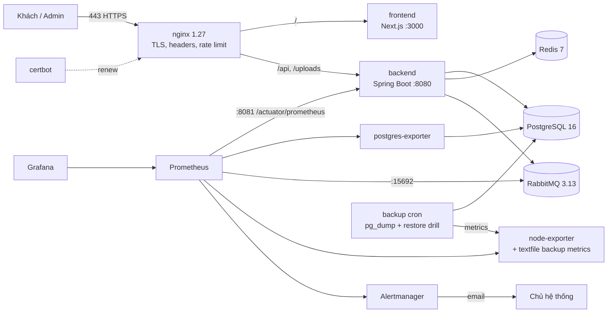

# Deployment Guide — Nhu Villas trên một VPS (Docker Compose)

- **Quyết định**: [ADR-0007](../adr/0007-docker-compose-vps-deployment.md) (Compose trên VPS) và [ADR-0011](../adr/0011-observability-stack.md) (giám sát)
- **Phạm vi**: dev (laptop), staging và production. Production và staging dùng cùng topology.
- **Vận hành hằng ngày**: xem [runbook.md](runbook.md)

## 1. Kiến trúc triển khai



| Thành phần | Có công khai không | Ghi chú |
|---|---|---|
| nginx | 80, 443 | Phần mặt ngoài duy nhất được mở ra Internet |
| backend, frontend, db, redis, rabbitmq | Không | Chỉ nằm trong mạng compose (R-19) |
| Prometheus | `127.0.0.1:9090` | Truy cập qua SSH tunnel |
| Grafana | `127.0.0.1:3001` | Truy cập qua SSH tunnel; đăng ký tài khoản bị tắt |
| Actuator | Port 8081 nội bộ | nginx trả 404 cho `/actuator/*` |

## 2. Các file Compose

| Môi trường | Lệnh | Env file |
|---|---|---|
| dev | `docker compose --env-file .env.dev -f docker-compose.yml -f docker-compose.dev.yml up -d --build` | `.env.dev` (copy từ `.env.dev.example`) |
| staging | `docker compose --env-file .env.staging -f docker-compose.yml -f docker-compose.prod.yml -f docker-compose.staging.yml up -d --build` | `.env.staging` (copy từ `.env.prod.example`, dùng khóa Stripe **test**) |
| prod | `docker compose --env-file .env.prod -f docker-compose.yml -f docker-compose.prod.yml up -d --no-build` | `.env.prod` (copy từ `.env.prod.example`) |

- Mọi secret đều bắt buộc; thiếu biến nào thì Compose dừng kèm thông báo.
- Các file `.env.dev/.env.staging/.env.prod` nằm trong `.gitignore`.
- CI kiểm chứng cả ba tổ hợp bằng `docker compose config`, và chặn trường hợp service dữ liệu bị publish port ở prod (job `infra-validate`).

## 3. Chuẩn bị VPS (một lần)

**Khuyến nghị cấu hình**: 4 vCPU, 8 GB RAM, 80 GB SSD, Ubuntu 24.04 LTS. Giới hạn tài nguyên trong `docker-compose.prod.yml` cộng lại khoảng 5,3 GB.

1. Tạo user `deploy` (không phải root), đăng nhập SSH bằng key, tắt đăng nhập bằng mật khẩu.
2. Cài Docker Engine và Compose plugin theo hướng dẫn chính thức. Thêm user `deploy` vào nhóm `docker`.
3. Bật firewall: chỉ mở `22/tcp` (nên giới hạn theo IP quản trị), `80/tcp` và `443/tcp`:
   ```bash
   sudo ufw default deny incoming && sudo ufw allow 22/tcp && sudo ufw allow 80,443/tcp && sudo ufw enable
   ```
4. Trỏ DNS `A`/`AAAA` của tên miền (ví dụ `nhuvillas.vn`) về IP của VPS.
5. Clone repo và cấu hình:
   ```bash
   sudo mkdir -p /srv/nhu-villas/backups && sudo chown -R deploy: /srv/nhu-villas
   git clone https://github.com/nhutruong47/hotel.git /srv/nhu-villas/app && cd /srv/nhu-villas/app
   cp .env.prod.example .env.prod && chmod 600 .env.prod   # điền mọi biến REQUIRED
   cp ops/alertmanager/alertmanager.yml.example ops/alertmanager/alertmanager.yml   # điền SMTP và người nhận
   ```
6. Đăng nhập GHCR, cần nếu package ở chế độ private: `echo <PAT có quyền read:packages> | docker login ghcr.io -u <user> --password-stdin`.

## 4. Lần triển khai đầu tiên (TLS)

```bash
cd /srv/nhu-villas/app
export $(grep -E '^SERVER_NAME=' .env.prod | xargs)
# 1) Chứng chỉ tạm để nginx khởi động được
sh ops/nginx/init-dummy-cert.sh "$SERVER_NAME" ./ops/certbot/conf
# 2) Khởi động stack (lần đầu chưa có backup cũ; backup chạy ngay khi container backup start)
REGISTRY=ghcr.io/<owner> sh ops/deploy/deploy.sh <commit-sha-trên-main>
# 3) Xin chứng chỉ thật rồi reload nginx
rm -rf ./ops/certbot/conf/live/$SERVER_NAME
docker compose --env-file .env.prod -f docker-compose.yml -f docker-compose.prod.yml run --rm --entrypoint certbot certbot \
  certonly --webroot -w /var/www/certbot -d "$SERVER_NAME" --email <email> --agree-tos --no-eff-email
docker compose --env-file .env.prod -f docker-compose.yml -f docker-compose.prod.yml exec nginx nginx -s reload
```

Sau đó:
- Container `certbot` tự gia hạn chứng chỉ mỗi 12 giờ. nginx reload mỗi 6 giờ (`ops/nginx/40-reload-certificates.sh`).
- Kiểm tra TLS và header bằng `curl -sI https://$SERVER_NAME`: phải có `strict-transport-security`, `x-frame-options: DENY` và `content-security-policy-report-only`.
- Kiểm tra mặt ngoài: `curl -s https://$SERVER_NAME/actuator/health` phải trả **404**.

## 5. Quy trình release (CI/CD)

1. Mở PR vào `develop`. CI chạy backend (unit + IT trên PostgreSQL), frontend, gitleaks, `infra-validate` và build image.
2. Merge `develop → main`. CI build và **push** `ghcr.io/<owner>/hotel-backend:<sha>` và `hotel-frontend:<sha>` (kèm tag `latest`).
3. Vào **Actions → Deploy → Run workflow**, nhập `image_tag` là SHA đầy đủ của commit trên `main`.
   - Workflow chạy trong GitHub Environment `production`. Hãy bật *Required reviewers* để mỗi lần deploy đều phải có người duyệt.
   - Secrets cần khai báo trong environment: `VPS_HOST`, `VPS_USER`, `VPS_SSH_KEY`, `VPS_KNOWN_HOSTS` (lấy từ `ssh-keyscan -H <host>`), `VPS_APP_DIR` (ví dụ `/srv/nhu-villas/app`).
4. `ops/deploy/deploy.sh` lần lượt: backup trước khi deploy, `pull`, `up -d`, đợi backend `healthy`. Nếu backend không lên được thì **tự rollback image** về bản trước.

Lưu ý: migration DB **không** tự rollback. Trước mỗi release có migration mới, chạy thử trên bản restore (§7 và [p2-release-notes.md](p2-release-notes.md)).

## 6. Giám sát

| Việc | Cách làm |
|---|---|
| Mở Grafana | `ssh -L 3001:127.0.0.1:3001 deploy@vps`, rồi vào http://localhost:3001 (user `admin`, mật khẩu `GRAFANA_ADMIN_PASSWORD`). Dashboard "Nhu Villas — Overview" |
| Mở Prometheus | `ssh -L 9090:127.0.0.1:9090 deploy@vps`, rồi vào http://localhost:9090/alerts |
| Đọc log | `docker compose ... logs -f backend`. Backend ghi JSON ECS mỗi dòng một object, có `requestId`. nginx ghi JSON có `request_id`, cùng giá trị với header `X-Request-Id` |
| Xoay vòng log | Driver `json-file`: 20 MB × 5 file cho mỗi container |

Các alert và cách xử lý được liệt kê trong [runbook.md](runbook.md).

## 7. Backup và khôi phục

| Hạng mục | Giá trị |
|---|---|
| Lịch | `pg_dump` hằng ngày lúc 02:15; restore drill ngày 1 hằng tháng lúc 03:30 (container `backup`) |
| Nơi lưu | `BACKUP_HOST_DIR` (mặc định `/srv/nhu-villas/backups`), giữ `BACKUP_RETENTION_DAYS` ngày (14), mỗi file kèm checksum `.sha256` |
| Off-site | `BACKUP_OFFSITE_CMD`, ví dụ `rclone`. **Rất nên bật**: nếu VPS hỏng thì mất cả backup cục bộ |
| Giám sát | Alert `BackupMissing` khi quá 26 giờ không có backup thành công (RPO 24 giờ) |
| Chạy drill thủ công | `docker compose ... exec backup sh -c '. /etc/backup.env && sh /ops/backup/restore-drill.sh'` |

Quy trình khôi phục thật (sự cố): [runbook.md#restore-from-backup](runbook.md#restore-from-backup).

## 8. Render/Vercel (hiện trạng) → VPS

- Dockerfile backend vẫn giữ tham số JVM cho container 512 MB, nên bản deploy Render hiện tại **không bị ảnh hưởng**. Compose trên VPS ghi đè bằng `JAVA_OPTS=-XX:MaxRAMPercentage=75`.
- Trên Render, actuator chỉ mở `health,info` ở port chính (mặc định `MANAGEMENT_ENDPOINTS`). Prometheus chỉ được mở trên VPS, qua port nội bộ.
- Chuyển hẳn sang VPS:
  1. Dựng VPS theo §3–4 và dùng một subdomain tạm để kiểm thử.
  2. `pg_dump` dữ liệu Render, rồi `pg_restore` vào DB trên VPS.
  3. Đổi DNS sang VPS.
  4. Giữ Render ở chế độ chỉ đọc 48 giờ để có đường lùi.
