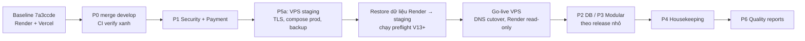

# Implementation Plan & Migration Roadmap — Nhu Villas

| Thuộc tính | Giá trị |
|---|---|
| Ngày | 2026-11-20 |
| Trạng thái | P0 xong trên `feature/p0-hardening` (CI xanh). P1 xong phần lớn trên `feature/p1-security-payment` — xem §3 P1. Cả hai chờ merge `develop` |
| Chiến lược | Incremental refactoring (strangler) — không big-bang rewrite, hệ thống luôn chạy được sau mỗi bước |
| Đầu vào | [architecture-assessment.md](../reports/architecture-assessment.md), [technical-debt.md](../reports/technical-debt.md), [risk-register.md](../reports/risk-register.md), [target-architecture.md](../architecture/target-architecture.md) |

---

## 1. Nguyên tắc thực thi

1. Mỗi phase giao trên **nhánh riêng → PR → CI xanh → merge `develop`**; `main` chỉ nhận bản đã qua staging.
2. Mỗi thay đổi hành vi kèm test chứng minh (unit, hoặc IT với Testcontainers cho DB/concurrency).
3. Không xóa chức năng khi chưa xác định tác động; deprecate trước, xóa ở release sau.
4. Không tự nhận "hoàn thành" khi chưa có bằng chứng test; ghi rõ phần chưa kiểm chứng.
5. Cuối mỗi phase: chạy toàn bộ test, cập nhật tài liệu và [risk-register.md](../reports/risk-register.md), báo cáo hoàn thành và rủi ro còn tồn đọng.

## 2. Priority Matrix

| Ưu tiên | Hạng mục | Impact | Effort | Rủi ro xử lý | TD / Risk |
|---|---|---|---|---|---|
| **P0** | CSRF cookie; day-use overlap; refund double-count; DTO thay entity; V13 EXCLUDE; Testcontainers + CI `verify`; rotate Gemini key (repo owner) | Cao | S–M | R-01..R-07, R-24 | TD-01..06 |
| **P1-Security** | `@PreAuthorize` + RoleHierarchy; bỏ `admin123`; email verification ở prod; ẩn demo login; Spring Session + rate limit + lockout trên Redis; FE session stale; gitleaks + OWASP dependency-check/Dependabot — **phần lớn xong; Redis/Spring Session, OWASP dependency-check, `middleware.ts` chuyển sang P3/P5** | Cao | M | R-11..R-15, R-18 | TD-13..18, TD-40 |
| **P1-Payment** | Reuse Stripe session/intent; refund SePay/manual `PENDING_MANUAL`; lưu SePay mismatch; reconciliation job; release promotion; sửa `modifyBooking`; Idempotency-Key tạo booking; dedupe webhook event — **phần lớn xong; reconciliation job với Stripe API, bảng dedupe webhook event, bảng `booking_idempotency` chuyển sang P2/P3** | Cao | M | R-08..R-10, R-20, R-21 | TD-07..12 |
| **P2-DB** | V15–V25 (đánh số lại; xem [database-design.md §4](../architecture/database-design.md#4-thay-đổi-schema-mục-tiêu-p2-và-sau-đó)); `Integer → Long`; archive H2/SQL Server/legacy-mvc — **V15–V20 xong** (`feature/p2-database`, [ADR-0010](../adr/0010-p2-schema-hardening-scope.md), [release notes](../operations/p2-release-notes.md)); H2 track + SQL Server scripts đã xóa; `Integer → Long` hoãn có lý do; V21+ và `legacy-mvc` để sau | Trung bình – Cao | M–L | R-07 | TD-19..25, TD-37, TD-43 |
| **P3-Modular** | Package theo module; Facade; ArchUnit; tách `BookingService`/`AdminApi`; ShedLock; dọn dead code | Trung bình | L | R-23 | TD-26..30, TD-36 |
| **P4-Housekeeping** | Room status, cleaning task, assignment, gắn inspection (sau khi Q8 được trả lời) | Trung bình | M | R-22 | — |
| **P5-DevOps/Obs** | Compose dev/staging/prod; nginx TLS; CI build image → GHCR → deploy VPS; Micrometer/Prometheus/Grafana/Loki; JSON log; pg_dump + restore drill; `.env.example` chuẩn | Cao | M | R-15..R-17, R-19 | TD-31..34, TD-42 |
| **P6-Quality** | k6 load test; OWASP ZAP baseline; chaos (DB/RabbitMQ down, gateway timeout); báo cáo performance và security | Trung bình | M | — | TD-35 |
| **P7** | Inventory, Employee/shift | Thấp – Trung bình | L | — | — |

Ghi chú thứ tự: P5 có thể chạy song song với P2/P3 (do DevOps đảm nhận). Riêng phần TLS/secret của P5 nên làm **trước go-live**, cùng lúc với P1.

## 3. Chi tiết từng phase

### P0 — Critical fixes (nhánh `feature/p0-hardening`)

| # | Việc | Tiêu chí hoàn thành |
|---|---|---|
| 1 | CSRF cookie không còn thuộc tính `HttpOnly` | `CsrfCookieFilterTest`: `Set-Cookie` không chứa `HttpOnly`; thiếu header thì trả 403; kiểm thử thủ công trên trình duyệt (AC-07) |
| 2 | Day-use chiếm `[d, d+1)` ở mọi conflict query (`booking/model/Occupancy.java`) | Test: day-use trùng day-use bị chặn; day-use trùng ngày check-in của booking khác bị chặn; check-out D cùng check-in D vẫn hợp lệ |
| 3 | `booking.refundAmount` = tổng đã hoàn thực tế (idempotent) | `PaymentServiceTest`: hủy 100% rồi refund full → `refundAmount == totalPrice` (AC-05) |
| 4 | DTO cho mọi response admin/payment/timeline/account | `NoEntityLeakIntegrationTest` (open-in-view=false, không test transaction): 200 + không lộ bank/raw gateway/password hash. Static rule ArchUnit để P3 (response hiện bọc trong `Map.of`, kiểu trả về không phản ánh entity) |
| 5 | V13 + rollback script + map `23P01 → 409` | `BookingOverlapConstraintIT`, `PostgresMigrationIT` (AC-02) |
| 6 | Testcontainers + failsafe; CI `./mvnw -B verify` | CI xanh, có log các IT đã chạy |
| 7 | Rotate Gemini key | Repo owner xác nhận key cũ đã bị revoke |

### P1-Security (nhánh `feature/p1-security-payment`)

Kế hoạch ban đầu được giữ ở cột "Việc"; cột "Kết quả" ghi những gì thực sự đã làm. Quyết định nghiệp vụ liên quan: [ADR-0009](../adr/0009-business-policy-decisions.md).

| # | Việc (kế hoạch) | Kết quả | Bằng chứng |
|---|---|---|---|
| S1 | `RoleHierarchy` + `@PreAuthorize`, thay 16 chỗ `"ADMIN".equals(...)`; test tham số hóa endpoint × role (AC-06) | ✔ Thay bằng helper `security/Authz.java` (`UserRole.includes`); `SessionAuthBridgeFilter` đã cấp authority theo hierarchy nên `hasRole('MANAGER')` đúng cho ADMIN. Xem booking/payment: owner hoặc STAFF+; `GET /payments`: MANAGER+; refund/xác nhận refund: ADMIN. ⚠ Chưa có test tham số hóa đầy đủ (TD-49 → P6) | Các case role sẵn có trong `BookingFlowIntegrationTest`, `NoEntityLeakIntegrationTest` |
| S2 | `AdminCredentialValidator`: default chỉ khi profile `dev` tường minh | ✔ Profile khác không có credentials → bỏ qua bootstrap (log WARN); `prod` fail-fast | `AdminCredentialValidatorTest` (6) |
| S3 | Không tự verify email ở prod | ✔ Opt-in `app.auth.auto-verify-without-email` (mặc định `false`; `true` ở `dev`/`postgres`/test); email tắt + cờ tắt → `REGISTRATION_UNAVAILABLE` | `UserServiceVerificationPolicyTest` (3) |
| S4 | FE: demo login sau flag; `SessionProvider` xóa cache khi `user:null`; `middleware.ts` | ✔ Demo login (`NEXT_PUBLIC_ENABLE_DEMO_LOGIN` + `NEXT_PUBLIC_DEMO_LOGIN_PASSWORD`); ✔ `SessionProvider`; ❌ `middleware.ts` chưa làm | CI `frontend-check` (tsc + build); chưa có test UI |
| S5 | Spring Session Redis; Bucket4j-Redis; `ClientIpResolver` chỉ tin nginx | ⚠ Rate limiter viết lại nhưng **vẫn in-memory**: chỉ áp `/api/**`, bucket nhạy cảm riêng (`login/register/forgot/reset/resend/ai/contact/POST bookings`, mặc định 10/phút/IP), evict window hết hạn. Spring Session Redis, Bucket4j-Redis, trusted proxy list → P3/P5 | `RateLimitFilterTest` (4) |
| S6 | CI: gitleaks, Dependabot, OWASP dependency-check | ✔ gitleaks 8.21.2 quét working tree (`.gitleaks.toml`, job `secret-scan`); ✔ `.github/dependabot.yml` (maven, npm, actions). ❌ OWASP dependency-check → P6. Lịch sử git không được quét (key cũ chờ rotate, R-01) | Chạy local: `no leaks found` |

### P1-Payment (nhánh `feature/p1-security-payment`)

| # | Việc (kế hoạch) | Kết quả | Bằng chứng |
|---|---|---|---|
| P1 | Một Stripe Checkout Session `open` mỗi booking; idempotency key | ✔ Reuse session `open` cùng số tiền; session cũ (hết hạn/đổi tiền) bị expire + payment `FAILED` "Superseded"; key `checkout-{booking}-{amount}-{attempt}`; `expires_at` = now + 31'. ✔ Reuse PaymentIntent còn confirm được (`/payments/intent`). Chặn Stripe khi tổng < 10.000 VND | ⚠ **Chưa có test tự động** (cần Stripe test mode / stripe-mock — TD-50) |
| P2 | Refund không qua Stripe → trạng thái chờ thủ công | ✔ `PENDING_MANUAL` (V14) → `POST /payments/{id}/refunds/{refundId}/confirm {bankReference}` hoặc `/reject`; refund chờ được tính vào giới hạn hoàn; adapter không bao giờ báo success giả; UI admin "Manual refunds awaiting bank transfer" | `PaymentServiceTest$ReconciliationAndManualRefundTests` (7), `StripePaymentAdapterTest`, `ManualRefundIT` |
| P3 | SePay mismatch/late/duplicate → `reconciliation_items` + báo ADMIN | ✔ Thay bằng cờ `payments.review_required` + `review_reason` (V14), thông báo in-app cho ADMIN, hàng đợi `GET /payments?reviewRequired=true`; Stripe webhook lệch tiền không còn throw | `SepayWebhookApiTest`, `webhookAmountMismatchIsRecordedNotThrown` |
| P4 | Job đối soát hằng ngày với Stripe API (ShedLock) | ❌ Chuyển P3 (cùng ShedLock, V23) | — |
| P5 | Release promotion; viết lại `modifyBooking` | ✔ `VoucherService.releaseDiscountCode`; `modifyBooking` tái định giá qua `booking/service/PricingPolicy.java`, kiểm tra availability + bảo trì + min/max stay; `PAID` đổi tổng → `MODIFICATION_REQUIRES_SUPPORT` (ADR-0009 Q3) | `BookingPolicyIntegrationTest` (6), `BookingServiceTest` |
| P6 | `POST /bookings` nhận `Idempotency-Key` | ⚠ Natural idempotency thay thế: cùng khách gửi lại cùng villa/ngày/số khách khi hold còn hiệu lực → trả booking cũ. Bảng `booking_idempotency` (V22) tùy chọn | `BookingFlowIntegrationTest.testDuplicateSubmitIsIdempotent` |
| P7 (thêm) | Chính sách giá & tiền tệ (ADR-0009 Q6, Q7, Q11) | ✔ `PricingPolicy` (VND; phụ thu 625.000 VND cấu hình được; phí/VAT sau giảm giá); `pricing-preview` nhận `code`, FE hiển thị số của server; seed VND; `CurrencySanityCheck`; hóa đơn PDF VND không trừ giảm giá 2 lần; prompt Gemini VND | `PricingPolicyTest` (6), `BookingServiceTest` cập nhật |
| P8 (thêm) | Lưu trữ dữ liệu (ADR-0009 Q9) | ✔ Audit `PAYMENT_*` 10 năm / còn lại 180 ngày; xóa bank details 180 ngày sau hủy (trừ refund `PENDING_MANUAL`) | `ManualRefundIT` |

**Kết quả kiểm thử P1 (local, 2026-11-20):** 226 unit/H2 test xanh; 10 PostgreSQL IT xanh trên PostgreSQL 16.6; rollback U14 → áp lại V14 thành công. Frontend chỉ kiểm chứng qua CI.

**Chuyển sang phase sau:**

| Hạng mục | Phase mới | Lý do |
|---|---|---|
| Spring Session Redis, Bucket4j-Redis (rate limit/lockout phân tán), trusted proxy list cho `ClientIpResolver` | P3/P5 (cùng compose có Redis ở prod) | Chỉ cần khi chạy ≥ 2 instance (R-18) |
| ShedLock + job đối soát với Stripe API | P3 (V23) | Cần distributed lock trước |
| Bảng dedupe webhook event (`payment_webhook_events`) | P2 (V21) | Idempotency hiện dựa trên unique `transaction_ref`/`intent_id` + row lock — đủ cho quy mô hiện tại |
| nginx TLS/headers/CORS | P5 | Hạ tầng VPS |
| OWASP dependency-check, test ma trận role × endpoint, test Stripe test mode | P6 | Chất lượng |
| `middleware.ts` FE | P5 (cùng hardening FE) | Chỉ cải thiện UX |
### P2-DB, P3-Modular, P4-Housekeeping

Xem [database-design.md §4](../architecture/database-design.md#4-thay-đổi-schema-mục-tiêu-p2-và-sau-đó) và [target-architecture.md §2](../architecture/target-architecture.md#2-module). Thứ tự refactor module: `payment` (nhỏ, nhiều vi phạm boundary) → `booking` (tách service) → `property` → `identity` → `notification`/`audit` → `reporting` → `content`/`guest`.

### P5-DevOps & Observability

| Hạng mục | Sản phẩm |
|---|---|
| Compose | `docker-compose.{dev,staging,prod}.yml`; sửa mount `database/init-db.sql`; prod không publish cổng DB/Redis/RabbitMQ |
| nginx | TLS + HSTS + CSP; `security-headers.conf` được include ở mọi `location`; bỏ CORS `*`; `client_max_body_size 10m`; proxy `/uploads/` |
| CI/CD | Job `docker-build` (backend + frontend, cache), push GHCR khi merge `main`, `deploy` qua SSH với environment protection (cần approve) |
| Metrics | `micrometer-registry-prometheus`; expose `/actuator/prometheus` chỉ trong mạng nội bộ; custom metric cho outbox backlog, booking, webhook |
| Logs | `logstash-logback-encoder` (JSON) ở prod; Loki + Promtail |
| Alert | Backend down, 5xx > 1%, outbox oldest > 10 phút, DLQ > 0, disk > 80%, backup thất bại |
| Backup | `tools/backup/pg-backup.sh` + cron; `tools/backup/restore.sh`; runbook `docs/operations/backup-restore.md` |
| Docs | `docs/operations/deployment-guide.md`, `runbook.md` |

### P6-Quality

| Kịch bản | Công cụ | Tiêu chí |
|---|---|---|
| Nhiều người đặt cùng phòng | `BookingConcurrencyPostgresIT` + k6 (100 VU) | 0 booking chồng lịch (truy vấn kiểm tra sau test) |
| Thanh toán gửi nhiều lần | `DuplicatePaymentWebhookIT` (Stripe event + SePay ref lặp) | 1 payment, booking không đổi |
| Payment gateway timeout | WireMock/Toxiproxy cho Stripe | Refund ghi `FAILED`, không tăng tổng hoàn (AC-09) |
| Database connection failure | Toxiproxy cắt PostgreSQL | API trả 503 có envelope; Hikari phục hồi; không mất dữ liệu đã commit |
| RabbitMQ unavailable | Dừng `RabbitMQContainer` | Booking vẫn commit; outbox giữ sự kiện; gửi bù khi broker lên lại (AC-08) |
| Notification retry / DLQ | Consumer ném lỗi | Retry N lần rồi vào DLQ; không gửi email trùng với cùng `message_id` |
| Unauthorized access | Test ma trận role × endpoint; ZAP baseline | 401/403 đúng; ZAP không có High |
| Load | k6: tìm villa 50 RPS, tạo booking 10 RPS | p95 < 300/800 ms (NFR-02) |

Mỗi lỗi tìm được phải có bước tái hiện (test đỏ) và tiêu chí xác nhận đã sửa (test xanh).

## 4. Migration plan (lộ trình dữ liệu và triển khai)

Cutover từ Render/Vercel sang VPS:
1. Đóng băng deploy, `pg_dump` từ DB đang dùng ở production.
2. Restore lên staging VPS, chạy Flyway và preflight. Nếu có vi phạm thì xử lý thủ công và lập biên bản.
3. UAT trên staging với Stripe test mode.
4. Đặt cửa sổ bảo trì: chuyển Render sang read-only (hoặc tắt), dump lần cuối, restore lên prod VPS, chuyển DNS, cập nhật URL webhook Stripe/SePay.
5. Theo dõi 48 giờ; giữ Render để rollback DNS trong 7 ngày.

## 5. Definition of Done (toàn chương trình)

Đối chiếu với tiêu chí nghiệm thu của dự án:

| Tiêu chí | Bằng chứng | Phase |
|---|---|---|
| Business workflows rõ ràng | [business-analysis.md](../business/business-analysis.md); Q1–Q7, Q9, Q11 đã chốt ([ADR-0009](../adr/0009-business-policy-decisions.md)); còn Q8, Q10 | BA |
| Architecture có tài liệu, module boundary xác định | [target-architecture.md](../architecture/target-architecture.md), ArchUnit xanh | P3 |
| Database thiết kế hợp lý | [database-design.md](../architecture/database-design.md), V13–V14 (xong), V15–V25 (kế hoạch) | P0/P1/P2 |
| Booking concurrency được kiểm thử | `BookingConcurrencyPostgresIT`, k6 | P0/P6 |
| Payment chống xử lý trùng | Unique ref/intent, dedupe webhook event, IT | P0/P1 |
| Security được đánh giá | Security report (ASVS L2 checklist + ZAP) | P1/P6 |
| Automated testing, CI/CD | GitHub Actions `verify` + build + deploy | P0/P5 |
| Deployment guide, monitoring, backup và recovery | `docs/operations/*`, Grafana, restore drill log | P5 |
| ADR | [docs/adr](../adr/README.md) | Liên tục |
| Báo cáo performance và security | `docs/reports/performance-report.md`, `security-report.md` | P6 |
