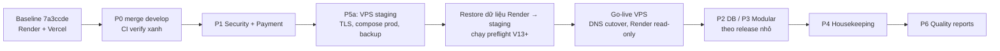

# Implementation Plan & Migration Roadmap — Nhu Villas

| Thuộc tính | Giá trị |
|---|---|
| Ngày | 2026-11-20 |
| Chiến lược | Incremental refactoring (strangler) — không big-bang rewrite, hệ thống luôn chạy được sau mỗi bước |
| Đầu vào | [architecture-assessment.md](../reports/architecture-assessment.md), [technical-debt.md](../reports/technical-debt.md), [risk-register.md](../reports/risk-register.md), [target-architecture.md](../architecture/target-architecture.md) |

---

## 1. Nguyên tắc thực thi

1. Mỗi phase giao trên **nhánh riêng → PR → CI xanh → merge `develop`**; `main` chỉ nhận bản đã qua staging.
2. Mỗi thay đổi hành vi kèm test chứng minh (unit, hoặc IT với Testcontainers cho DB/concurrency).
3. Không xóa chức năng khi chưa xác định tác động; deprecate trước, xóa ở release sau.
4. Không tự nhận "hoàn thành" khi chưa có bằng chứng test; ghi rõ phần chưa kiểm chứng.
5. Cuối mỗi phase: chạy toàn bộ test, cập nhật tài liệu và [risk-register.md](../reports/risk-register.md), báo cáo hoàn thành và rủi ro còn tồn đọng.

## 2. Priority Matrix

| Ưu tiên | Hạng mục | Impact | Effort | Rủi ro xử lý | TD / Risk |
|---|---|---|---|---|---|
| **P0** | CSRF cookie; day-use overlap; refund double-count; DTO thay entity; V13 EXCLUDE; Testcontainers + CI `verify`; rotate Gemini key (repo owner) | Cao | S–M | R-01..R-07, R-24 | TD-01..06 |
| **P1-Security** | `@PreAuthorize` + RoleHierarchy; bỏ `admin123`; email verification ở prod; ẩn demo login; Spring Session + rate limit + lockout trên Redis; FE session stale; gitleaks + OWASP dependency-check/Dependabot | Cao | M | R-11..R-15, R-18 | TD-13..18, TD-40 |
| **P1-Payment** | Reuse Stripe session/intent; refund SePay/manual `MANUAL_PENDING`; lưu SePay mismatch; reconciliation job; release promotion; sửa `modifyBooking`; Idempotency-Key tạo booking; dedupe webhook event | Cao | M | R-08..R-10, R-20, R-21 | TD-07..12 |
| **P2-DB** | V14–V23 (xem [database-design.md §4](../architecture/database-design.md#4-thay-đổi-schema-mục-tiêu-p2-và-sau-đó)); `Integer → Long`; archive H2/SQL Server/legacy-mvc | Trung bình – Cao | M–L | R-07 | TD-19..25, TD-37, TD-43 |
| **P3-Modular** | Package theo module; Facade; ArchUnit; tách `BookingService`/`AdminApi`; ShedLock; dọn dead code | Trung bình | L | R-23 | TD-26..30, TD-36 |
| **P4-Housekeeping** | Room status, cleaning task, assignment, gắn inspection (sau khi Q8 được trả lời) | Trung bình | M | R-22 | — |
| **P5-DevOps/Obs** | Compose dev/staging/prod; nginx TLS; CI build image → GHCR → deploy VPS; Micrometer/Prometheus/Grafana/Loki; JSON log; pg_dump + restore drill; `.env.example` chuẩn | Cao | M | R-15..R-17, R-19 | TD-31..34, TD-42 |
| **P6-Quality** | k6 load test; OWASP ZAP baseline; chaos (DB/RabbitMQ down, gateway timeout); báo cáo performance và security | Trung bình | M | — | TD-35 |
| **P7** | Inventory, Employee/shift | Thấp – Trung bình | L | — | — |

Ghi chú thứ tự: P5 có thể chạy song song với P2/P3 (do DevOps đảm nhận). Riêng phần TLS/secret của P5 nên làm **trước go-live**, cùng lúc với P1.

## 3. Chi tiết từng phase

### P0 — Critical fixes (nhánh `feature/p0-hardening`)

| # | Việc | Tiêu chí hoàn thành |
|---|---|---|
| 1 | CSRF cookie không còn thuộc tính `HttpOnly` | `CsrfCookieFilterTest`: `Set-Cookie` không chứa `HttpOnly`; thiếu header thì trả 403; kiểm thử thủ công trên trình duyệt (AC-07) |
| 2 | Day-use chiếm `[d, d+1)` ở mọi conflict query (`booking/model/Occupancy.java`) | Test: day-use trùng day-use bị chặn; day-use trùng ngày check-in của booking khác bị chặn; check-out D cùng check-in D vẫn hợp lệ |
| 3 | `booking.refundAmount` = tổng đã hoàn thực tế (idempotent) | `PaymentServiceTest`: hủy 100% rồi refund full → `refundAmount == totalPrice` (AC-05) |
| 4 | DTO cho mọi response admin/payment/timeline/account | `NoEntityLeakIntegrationTest` (open-in-view=false, không test transaction): 200 + không lộ bank/raw gateway/password hash. Static rule ArchUnit để P3 (response hiện bọc trong `Map.of`, kiểu trả về không phản ánh entity) |
| 5 | V13 + rollback script + map `23P01 → 409` | `BookingOverlapConstraintIT`, `PostgresMigrationIT` (AC-02) |
| 6 | Testcontainers + failsafe; CI `./mvnw -B verify` | CI xanh, có log các IT đã chạy |
| 7 | Rotate Gemini key | Repo owner xác nhận key cũ đã bị revoke |

### P1-Security

- `SecurityConfig`: `RoleHierarchy`, `@EnableMethodSecurity`. Thay 16 chỗ `"ADMIN".equals(...)` bằng `@PreAuthorize`/`hasRole` theo ma trận `BOOKING_LIFECYCLE_AND_RBAC.md:130-139`. Viết test tham số hóa cho từng endpoint × role (AC-06).
- `AdminCredentialValidator`: chỉ dùng default khi profile `dev` được khai báo tường minh; ngoài trường hợp đó thiếu `APP_ADMIN_PASSWORD` thì fail-fast.
- `UserService.login`: ở prod không tự verify email. Bắt buộc có email provider; nếu không có thì chặn đăng ký.
- FE: demo login chỉ hiện khi `NEXT_PUBLIC_ENABLE_DEMO_LOGIN=true` (dev/staging); sửa `SessionProvider` để xóa cache khi server trả `user:null`; thêm `middleware.ts` chặn `/admin` khi không có session cookie (chỉ cải thiện UX, backend vẫn là nơi quyết định).
- Spring Session Redis; Bucket4j-Redis cho `/auth/login`, `POST /bookings`, `/ai/recommend`; `ClientIpResolver` chỉ tin `X-Forwarded-For` từ IP của nginx.
- CI: gitleaks (cấu hình allowlist cho commit `efd7e35` **sau khi** key đã được rotate), Dependabot, OWASP dependency-check.

### P1-Payment

- Mỗi booking chỉ có một Stripe Checkout Session đang `open`: tái sử dụng nếu còn hạn, và truyền idempotency key `booking-{id}-attempt-{n}`.
- Refund không đi qua Stripe → `MANUAL_PENDING`; ADMIN xác nhận đã chuyển khoản (có số tham chiếu) → `SUCCEEDED`.
- SePay mismatch/late/duplicate → ghi `reconciliation_items` và gửi thông báo cho ADMIN.
- Job đối soát hằng ngày (ShedLock): so payment `PENDING` với Stripe API, liệt kê booking `EXPIRED` có tiền vào.
- `releasePromotionUse` khi expire/cancel. Viết lại `modifyBooking` dùng chung `PricingService` và kiểm tra availability/maintenance; nếu booking đã PAID thì phần chênh lệch đi qua payment/refund (theo Q3).
- `POST /bookings` nhận `Idempotency-Key` (bảng `booking_idempotency`).

### P2-DB, P3-Modular, P4-Housekeeping

Xem [database-design.md §4](../architecture/database-design.md#4-thay-đổi-schema-mục-tiêu-p2-và-sau-đó) và [target-architecture.md §2](../architecture/target-architecture.md#2-module). Thứ tự refactor module: `payment` (nhỏ, nhiều vi phạm boundary) → `booking` (tách service) → `property` → `identity` → `notification`/`audit` → `reporting` → `content`/`guest`.

### P5-DevOps & Observability

| Hạng mục | Sản phẩm |
|---|---|
| Compose | `docker-compose.{dev,staging,prod}.yml`; sửa mount `database/init-db.sql`; prod không publish cổng DB/Redis/RabbitMQ |
| nginx | TLS + HSTS + CSP; `security-headers.conf` được include ở mọi `location`; bỏ CORS `*`; `client_max_body_size 10m`; proxy `/uploads/` |
| CI/CD | Job `docker-build` (backend + frontend, cache), push GHCR khi merge `main`, `deploy` qua SSH với environment protection (cần approve) |
| Metrics | `micrometer-registry-prometheus`; expose `/actuator/prometheus` chỉ trong mạng nội bộ; custom metric cho outbox backlog, booking, webhook |
| Logs | `logstash-logback-encoder` (JSON) ở prod; Loki + Promtail |
| Alert | Backend down, 5xx > 1%, outbox oldest > 10 phút, DLQ > 0, disk > 80%, backup thất bại |
| Backup | `tools/backup/pg-backup.sh` + cron; `tools/backup/restore.sh`; runbook `docs/operations/backup-restore.md` |
| Docs | `docs/operations/deployment-guide.md`, `runbook.md` |

### P6-Quality

| Kịch bản | Công cụ | Tiêu chí |
|---|---|---|
| Nhiều người đặt cùng phòng | `BookingConcurrencyPostgresIT` + k6 (100 VU) | 0 booking chồng lịch (truy vấn kiểm tra sau test) |
| Thanh toán gửi nhiều lần | `DuplicatePaymentWebhookIT` (Stripe event + SePay ref lặp) | 1 payment, booking không đổi |
| Payment gateway timeout | WireMock/Toxiproxy cho Stripe | Refund ghi `FAILED`, không tăng tổng hoàn (AC-09) |
| Database connection failure | Toxiproxy cắt PostgreSQL | API trả 503 có envelope; Hikari phục hồi; không mất dữ liệu đã commit |
| RabbitMQ unavailable | Dừng `RabbitMQContainer` | Booking vẫn commit; outbox giữ sự kiện; gửi bù khi broker lên lại (AC-08) |
| Notification retry / DLQ | Consumer ném lỗi | Retry N lần rồi vào DLQ; không gửi email trùng với cùng `message_id` |
| Unauthorized access | Test ma trận role × endpoint; ZAP baseline | 401/403 đúng; ZAP không có High |
| Load | k6: tìm villa 50 RPS, tạo booking 10 RPS | p95 < 300/800 ms (NFR-02) |

Mỗi lỗi tìm được phải có bước tái hiện (test đỏ) và tiêu chí xác nhận đã sửa (test xanh).

## 4. Migration plan (lộ trình dữ liệu và triển khai)

Cutover từ Render/Vercel sang VPS:
1. Đóng băng deploy, `pg_dump` từ DB đang dùng ở production.
2. Restore lên staging VPS, chạy Flyway và preflight. Nếu có vi phạm thì xử lý thủ công và lập biên bản.
3. UAT trên staging với Stripe test mode.
4. Đặt cửa sổ bảo trì: chuyển Render sang read-only (hoặc tắt), dump lần cuối, restore lên prod VPS, chuyển DNS, cập nhật URL webhook Stripe/SePay.
5. Theo dõi 48 giờ; giữ Render để rollback DNS trong 7 ngày.

## 5. Definition of Done (toàn chương trình)

Đối chiếu với tiêu chí nghiệm thu của dự án:

| Tiêu chí | Bằng chứng | Phase |
|---|---|---|
| Business workflows rõ ràng | [business-analysis.md](../business/business-analysis.md), các câu hỏi Q1–Q11 đã được trả lời | BA |
| Architecture có tài liệu, module boundary xác định | [target-architecture.md](../architecture/target-architecture.md), ArchUnit xanh | P3 |
| Database thiết kế hợp lý | [database-design.md](../architecture/database-design.md), V13–V23 | P0/P2 |
| Booking concurrency được kiểm thử | `BookingConcurrencyPostgresIT`, k6 | P0/P6 |
| Payment chống xử lý trùng | Unique ref/intent, dedupe webhook event, IT | P0/P1 |
| Security được đánh giá | Security report (ASVS L2 checklist + ZAP) | P1/P6 |
| Automated testing, CI/CD | GitHub Actions `verify` + build + deploy | P0/P5 |
| Deployment guide, monitoring, backup và recovery | `docs/operations/*`, Grafana, restore drill log | P5 |
| ADR | [docs/adr](../adr/README.md) | Liên tục |
| Báo cáo performance và security | `docs/reports/performance-report.md`, `security-report.md` | P6 |
